# Implantação de Rede IPv4 Segura com Gateway, Firewall (NFTABLES), Serviço de DNS Local e Logs de Segurança

## Cenário da Atividade

Uma organização possui duas redes internas distintas e precisa centralizar os serviços de infraestrutura em um gateway Linux. O equipamento deverá fornecer endereçamento automático, resolução de nomes e roteamento controlado entre as redes. A comunicação não será liberada de forma irrestrita: o firewall deverá aplicar uma política de menor privilégio e registrar tentativas bloqueadas.


**Objetivos de aprendizagem:**
- Construir uma topologia virtual segmentada em duas redes IPv4.
- Configurar interfaces de rede e roteamento entre sub-redes no Linux.
- Implantar DHCP com distribuição de endereço IP, gateway e servidor DNS.
- Implantar DNS com resolução direta e reversa.
- Criar um firewall stateful com nftables e política padrão de bloqueio.
- Diferenciar tráfego iniciado, tráfego de resposta e tráfego não autorizado.
- Interpretar logs, estados de conexão e capturas de pacotes.
- Documentar a implementação e validar os controles por meio de testes positivos e negativos.


**Arquitetura obrigatória**

O laboratório deverá utilizar três máquinas virtuais, sendo o VirtualBox uma das plataformas recomendadas, embora outros hipervisores poderão ser utilizados desde que a topologia e os resultados sejam equivalentes.


<br>


<br>

## Resolução

### Cenário Inicial

Este é um estudo de caso para a matéria “Segurança em Rede de Computadores" do curso de Redes de Computadores - IESB/EAD, no qual estaremos simulando uma infraestrutura de rede com máquinas virtuais, utilizando o VritualBox, sendo que o cenário básico possui estes três hosts: 


1. Debian Stable: versão 13.6.0 (Configuração básica: 512MB e 12 12BG)
2. Alpine Linux: versão 3.24.1 (Configuração básica: 256MB e 5GB)
3. Alpine Linux: versão 3.24.1 (Configuração básica: 256MB e 5GB)


O objetivo geral do experimento é o de criar duas redes internas representadas por cada uma das VMs Alpine Linux, de modo que estas redes internas estejam protegidas por um Gateway/Firewall que será feito pelo host Debian Stable.


Observe ainda, que este Gateway/Firewall deve prover ainda serviços de resolução local de nomes, na forma de um servidor DNS usando Bind9, além de realizar automaticamente a distribuição de endereços IPs, reservados, máscara de rede, gateway padrão e DNS, na forma de um DHCP4 Kea.


O resultado inicial da infraestrutura básica das duas redes internas separadas por um gateway com firewall nftables e com o endereçamento definido estaticamente:

- Rede interna A: 192.168.10.0/24
- Rede interna B: 192.168.20.0/24
- DNS externo: 8.8.8.8 (google.com) 


<br>


<br>

Podemos notar na imagem acima, que nessa configuração inicial da infraestrutura, as duas redes separadas estão ativas, mas separadas por um firewall nftables com regras básicas, de forma que enquanto o host gateway/firewall permite o tráfego dos hosts internos com ele e com a rede WAN, ele bloqueia o tráfego entre eles respectivamente. 


E como detalhes para a criação das duas redes internas, temos abaixo a configuração de três placas de rede no gateway/firewall Debian Stable no VirtualBox:


1. Placa 1: configurada no modo NAT diretamente no ponto de acesso
2. Placa 2: configurada no modo Rede Interna 
3. Placa 3: configurada no modo Rede Interna

<br>


<br>

### Implementação dos Requisitos Técnicos da Infraestrutura

1. **Gateway Linux e Roteamento**

- Utilizar uma versão estável e atualizada do Debian.
- Configurar uma interface para cada rede interna, com os endereços de gateway definidos no plano de endereçamento.
- A terceira interface, em modo NAT, é opcional e deverá ser usada apenas para instalação e atualização de pacotes.
- Habilitar o encaminhamento IPv4 em tempo de execução e de forma persistente.
- Validar as interfaces e rotas com comandos apropriados, incluindo ip -br address e ip route.


<br>

A imagem do Debian Stable usado neste projeto foi baixada do site [Debian.org](https://www.debian.org/index.pt.html), tratando-se de um Debian na versão 13.6.0, a qual foi instalada a partir de uma configuração mínima:


- Standard system utilities
- SSH server


<br>

O gateway/firewall foi configurado com três interfaces de rede:


1. Rede Loopback: rede interna do kernel do host
2. Rede WAN: caminho de entrada e saída para o roteador da rede principal.
3. Rede Interna-A: 192.168.10.0/24
4. Rede Interna-B: 192.168.20.0/24


<br> 
Observe que essa configuração foi feita diretamente no arquivo /etc/network/interfaces e está relacionada a cada uma das placas de rede habilitadas na configuração da VM pelo VirtualBox.


A configuração do arquivo como um todo pode ser vista na parte final, na seção de apêndice, enquanto que aqui podemos analisar os principais comandos utilizados:  


- **inet:** esta palavra representa a família IPv4 com a qual se está trabalhando, de modo que se fosse o caso de se trabalhar IPv6, teríamos inet6.
- **lo ou loopback:** é a interface de operação do sistema operacional que permite a comunicação dos processos locais entre si, como, por exemplo, do BIND9 e do DHCP.
- **allow-hotplug:** usar esta diretiva é uma maneira interessante de se evitar que sistema ficasse emperrado em sua inicialização de boot, por causa da dependência para com a conexão da interface WAN, especialmente no momento em que esta estivesse indisponível.
- **auto:** já neste caso o sistema operacional é compelido a ativar obrigatoriamente a interface quando de sua inicialização.
- **static:** diretiva que marca a operação manual de definição do endereço da rede e de sua máscara. 


<br>

Note ainda que neste script em /etc/network/interfaces, ele foi escolhido como ponto para a habilitar o recurso de encaminhamento e roteamento de mensagens do host:


- **post-up:** está definido como um ‘hook’ do utilitário ifupdow, que instrui o sistema a rodar rodar o comando apenas após o ativamento bem sucedido da interface.
- **sysctl -w:** é uma ferramenta de linha de comando utilizada para modificar parâmetros do Kernel Linux em tempo de execução. Neste caso, a flag ‘w’ é para gravar o valor ‘1’ no arquivo /proc/sys/net/net.ipv4.ip_forward.


<br>

Abaixo, temos a imagem do resultado dos comando ip -br address e ip route, os quais permitem ao administrador retornar as configurações das interfaces do host em tempo real, incluindo a rota de saída WAN:


<br>


<br>

2. **Serviço DHCP**

- Implantar o Kea DHCP4 no gateway.
- Criar um escopo para cada rede interna.
- Distribuir endereço IP, máscara, gateway padrão e endereço do servidor DNS.
- Criar reservas por endereço MAC para que PC1 receba 192.168.10.10 e PC2 receba 192.168.20.10.
- Apresentar evidências dos leases e da obtenção automática dos parâmetros pelos dois clientes.


<br>

Para iniciar com os trabalhos com o serviço Kea DHCP, fazemos as instalações dos pacotes necessários no host:


- **apt update && apt install kea-dhcp4-server -y** 


Assim, no comando acima, fazemos o update do registro de pacotes do host e na sequência fazemos imediatamente a instalação do Kea DHCP e de suas dependências. 


Temos uma ferramenta do servidor Kea DHCP4 para fazer a análise do arquivo de configuração principal com:


- **kea-dhcp4 -t /ect/kea/kea-dhcp4.conf**

 
<br>

E, começando a configuração com o arquivo /etc/kea/kea-dhcp4.conf, temos um arquivo extenso do qual podemos sublinhar alguns pontos:


- Está voltado às interfaces das redes internas: enp0s8 e enp0s9
- Traz o nome de domínio da rede local: lab.seg.test
- Cria pools de IPs para as duas sub-redes: 192.168.10.0/24 e 192.168.20.0/24
- Cada sub-rede tem o IP do gateway de sua interface
- E cada host teve uma reserva de endereço: 192.168.10.10 e 192.168.20.10


<br>

Na sequência o procedimento é restartar o serviço, checar o estado final e ainda ir até log de serviço:


- **systemctl restart kea-dhcp4-server**
- **systemctl status kea-dhcp4-server**
- **journalctl -xeu kea-dhcp4-server.service**


<br>

Neste ponto, é preciso lembrar que o host principal que é o Debian Stable (gateway/firewall), ele teve as suas três interfaces configuradas manualmente pelo arquivo **/etc/network/interfaces**, como visto na seção anterior.


Já os hosts das redes interna, que são versões mais econômicas do sistema Linux, estes tiveram as suas configurações realizadas automaticamente pelo instalador da distro Alpine, o qual ele mesmo escreveu os seus respectivos arquivos de interface passando os IPs (192.168.10.2 e 192.168.20.2), além dos respectivos gateways.


Mas agora que já temos uma instalação funcional do servidor Kea DHCP4, então esses arquivos precisam ser reescritos passando a diretiva de recebimento dos endereços por meio de DHCP:


- **iface eth0 inet dhcp**


<br>

E, depois de reescritos os arquivos /etc/network/interfaces dos hosts (pc1 e pc2) das redes internas, é preciso reiniciar o serviço de rede para que as novas configurações possam agir.


Assim, podemos notar na imagem abaixo que nas duas VMs foi reiniciado o serviço de rede, de forma que podemos ver para cada uma delas o processo de descoberta sendo iniciado e depois a seleção aceita para os seus respectivos IPs e Gateways:

<br>


<br>

- **broadcasting discover**
- **broadcasting select for…**
- **Lease of … obtained from …, lease time 4000**
- **ip a show eth0**
- **ip route (default gateway)**


> [!NOTE]
> veja na próxima seção alguns testes relacionados à resolução de nomes pelo servidor DNS.


<br>

3. **Serviço DNS**


- Implantar o BIND9 como servidor autoritativo do domínio lab.seg.test.
- Criar registros A para gw, pc1 e pc2.
- Criar as zonas reversas e os respectivos registros PTR.
- Validar resolução direta e reversa com dig ou comando equivalente.
- Não utilizar o arquivo /etc/hosts como substituto do DNS. Ele poderá conter apenas entradas locais indispensáveis ao
- sistema


<br>

Para iniciar com os trabalhos do serviço de DNS, fazemos as instalações dos pacotes necessários no host:


- **apt update && apt install bind9 bind9-utils dnsutils -y**


<br>

Como no caso anterior, temos aqui que, o comando acima, faz o update do registro de pacotes do host e na sequência fazemos imediatamente a instalação do BIND9 e de suas dependências. Ademais, antes de começarmos a esmiuçar as principais configurações presentes em **/etc/bind/**, é interessante anotar que o BIND9 oferece uma ferramenta nativa de checagem de erros de sintaxe, da qual esperamos como saída uma mensagem de ‘OK’: **named-checkconf**.


- **named-checkzone lab.seg.test /etc/bind/db.lab.seg.test**
- **named-checkzone 10.168.192.in-addr.arpa /etc/bind/db.192.168.10**
- **named-checkzone 20.168.192.in-addr.arpa /etc/bind/db.192.168.20**


<br>

E, ao final das configurações do servidor BIND9, fazemos:


- **systemctl restart bind9**
- **systemctl enable bind9 ou systemctl enable named**


<br>
Começando, então, pelas configurações mais gerais em **/etc/bind/named.conf.options**, temos:
 

- **listen-on port 53:** estamos usando a porta padrão para o serviço DNS
- **allow-query { localhost; 192.168.10.0/24; 192.168.20.0/24; }:** estamos acrescentando segurança ao serviço, garantindo que ele esteja aberto para fazer resoluções externa à própria rede.
- **forwarders:** temos aqui um encaminhamento recursivo, ou seja, para as requisições das redes internas que não pertencem à própria rede local (lab.seg.test), mas que dizem respeito ao contexto WAN, o BIND9 as repassa para servidores públicos na Internet. 


<br>

A seguir, no arquivo **/etc/bind/named.conf.local**, temos a configuração local para o serviço autoritativo, em que vemos mapeados Zona Direta e Reversas e seus nomes próprios:


- Zona Direta (lab.seg.test)
- Zona Reversa da Rede A (10.168.192.in-addr.arpa): é interessante notar a notação reversa do formato de procura.
- Zona Reversa da Rede B (20.168.192.in-addr.arpa): é interessante notar a notação reversa do formato de procura.


<br>

Entendendo um pouco dos registros SOA e Registros de Recursos (RR):


- **/etc/bind/db.lab.seg.test**
- **/etc/bind/db.192.168.10**
- **/etc/bind/db.192.168.20**


<br>

Nesses arquivos temos configurações mapeando os ativos principais, em termos de nomes e de endereços, bem como podemos ver também diretivas de comportamento, como a definição de tempo para Refresh, Retry, Expire, etc.


Agora, abaixo temos o teste com pc1 que usa o comando dig para receber do servidor DNS (BIND9), que é a autoridade responsável por responder às resoluções de nome na rede interna:

<br>


<br>

E, de forma mais específica, podemos ver em cada resposta, que:


- **dig pc1.lab.seg.test (resolução direta):** retorna, entre outras coisas, qual é o endereço de IP relacionado com o nome de domínio passado.
- **dig -x 192.168.10.10 (busca reversa):** vemos que agora ao buscar através do endereço de IP, é temos como resposta retornado o nome de domínio relacionado.


A seguir, o mesmo resultado para **pc2**:

<br>
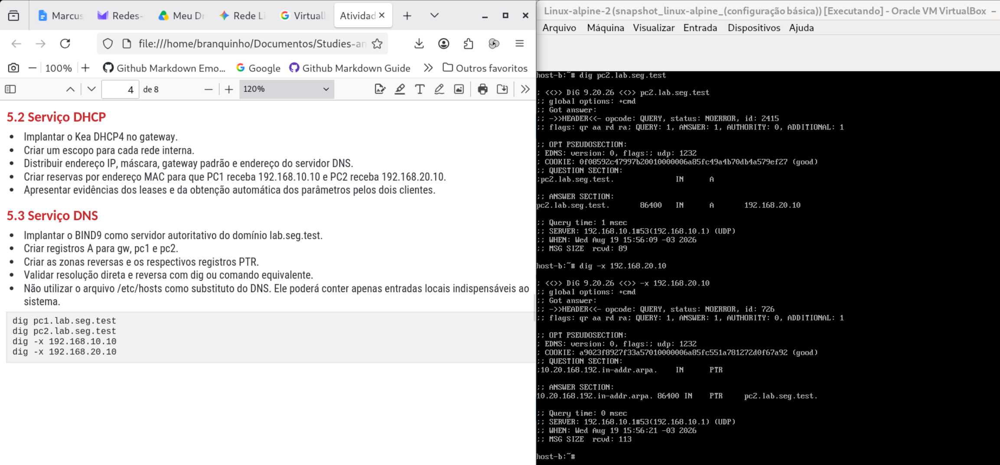


<br>

### Implementação dos Requisitos Técnicos do Firewall NFTables

O firewall utilizado deverá ser o nftables e as regras devem ser organizadas, comentadas e carregadas automaticamente durante a inicialização do sistema.


- Aplicar política padrão drop nas cadeias input e forward.
- Permitir tráfego de loopback e conexões nos estados established e related.
- Permitir DHCP e DNS somente pelas interfaces internas.
- Permitir que PC1 inicie ping para PC2 e receba a resposta correspondente.
- Bloquear novas solicitações de ping iniciadas por PC2 em direção ao PC1.
- Permitir administração SSH do gateway somente a partir do PC1.
- Registrar pacotes descartados com prefixo identificável e limitação de taxa para evitar excesso de logs.
- Manter as regras persistentes após reinicialização.


<br>

Lembrando dos aspectos gerais da arquitetura do firewall **nftables**, é preciso apontar que em termos gerais ele trabalha a partir de um do tipo: **Tabela -> Chain -> Regra**.


Nesse sentido, para este trabalho, definimos uma tabela apenas, de modo que ela está definida no padrão inet ou IPv4, para a qual estamos usando quatro das cinco chains existentes (PREROUTING, INPUT, FORWARD, OUTPUT, POSTROUTING):


- **PREROUTING:** responsável por pré-processar pacotes que entram no sistema, antes da decisão de roteamento.
- **INPUT:** responsável por tratar os pacotes destinados ao próprio host de firewall.
- **FORWARD:**  responsável por processar os pacotes de passagem pelo host, ou seja, os pacotes não direcionados ao firewall, mas que precisam ser roteador pela rede.
- **OUTPUT:** responsável por processar os pacotes gerados pelo próprio firewall.
- **POSTROUTING:** responsável por processar os pacotes destinados a serem roteados no momento imediatamente antes de saírem pela interface de rede (por exemplo, a tradução de endereços NAT).


<br>

Assim, neste trabalho nós começamos do trabalho do firewall na chain INPUT, definindo a política padrão da chain e permitindo a comunicação interna do host, por meio da interface de loopback, além de estabelecer o controle de estado também, o que significa que o firewall passa a mapear o conjunto das conexões a partir das conexões iniciais.


Isso é relevante principalmente como segurança para os protocolos orientados à conexão, em que um agente malicioso não tem como enviar pacotes soltos ou não iniciados na rede:


- **policy drop;**
- **iff “lo” accept**
- **ca state established,related accept**


<br>

A seguir, ainda na cadeia INPUT, permitimos DHCP e DNS apenas pelas interfaces internas, além de restringirmos a administração com SSH apenas a partir do host PC1 (192.168.10.10) na Rede A (192.169.10.0/24):


- **iifname { "enp0s8", "enp0s9" } udp dport { 53, 67 } accept**
- **iifname { "enp0s8", "enp0s9" } tcp dport 53 accept**
- **iifname "enp0s8" ip saddr 192.168.10.10 tcp dport 22 accept**


<br>

Finalmente, permitirmos o PING ou echo-request para o próprio diagnóstico do serviço de firewall, e finalizamos a chain registrando em log descartes de log:


- **iifname { "enp0s8", "enp0s9" } icmp type echo-request accept**
- **limit rate 5/minute log prefix "NFT-INPUT-DROP: " flags all**


<br>

Na chain FORWARD, novamente foram definidos os padrões da política, com DROP, e de uso de regras de estado:


- **policy drop**
- **ct state established,related accept**


<br>

A seguir foi permitido o uso do PING ou echo-request na rede interna, porém de forma limitada, ou seja, podendo ser usado apenas quando iniciado pelo host PC1 da Rede A na direção do host PC2 na Rede B (não confundir com a regra que permite o próprio firewall pode ser pingado pelos hosts para fins de diagnóstico da rede):


- **iifname "enp0s8" oifname "enp0s9" ip saddr 192.168.10.10 ip daddr 192.168.20.10 icmp type echo-request accept**


<br>

Finalmente, foi liberado o roteamento da rede interna para a WAN através do encaminhamento das conexões, lembrando ainda que por causa do uso de regras de estado, a rede interna permanece separada e protegida em relação às tentativas de conexão iniciadas pela rede pública ou externa, bem como também foi estabelecido controle de pacotes descartados com política de inscrição em log:


- **iifname { "enp0s8", "enp0s9" } oifname "enp0s3" accept**
- **limit rate 5/minute log prefix "NFT-FORWARD-DROP: " flags all**


<br> 

A chain de OUTPUT não possui nenhuma regra específica para este laboratório, enquanto que a chain POSTROUTING é responsável justamente por fazer aquela tradução de endereço NAT, para que as conexões iniciadas na rede interna pudessem alcançar a Internet, uma vez que esta não reconhece os endereços privados usados na rede interna:


- **policy accept**
- **oifname "enp0s3" masquerade**


<br>

### Plano dos Testes da Infraestrutura e a Política de Segurança

Em termos de  uma política de segurança, tanto para a instalação, quanto para o uso dos hosts, bem como com relação aos testes em geral, foi escolhido buscar um tipo de configuração que privilegia a ideia de Zero Trust ou da Política de Menor Privilégio, ou seja, a ideia de que cada recurso ou ativo participante da rede pode vir a ser um potencial  recurso hostil ou mesmo ser utilizado como tal por um agente hostil.


Nesse sentido, para este laboratório foram considerados alguns pontos básicos desse padrão para o principal recurso de segurança da rede interna, que é o host Debian Stable (gateway/firewall):


- Policy Drop: padrão do firewall NFTables para definir nas suas chains uma política final para lidar com o tráfego da rede, no sentido de que tudo aquilo que não estiver explicitamente permitido é bloqueado. 
- Resguardar a senha e o usuário do Root:  desta forma o usuário root e a sua senha não se confunde com a de quaisquer outros administradores e usuários do gateway/firewall.
- Proibição de acesso SSH como root: dessa forma, nos acessos administrativos ao host, ele só poderá ser logado por usuário comum, o qual precisará conhecer a senha local do root para ser capaz de realizar qualquer trabalho de administração.


<br>

Nesse sentido, para que a regra que impede o acesso do root ao gateway/firewall, fazemos a configuração no arquivo /etc//ssh/sshd_config, na diretiva apresentada abaixo:


- **PermitRootLogin no**


<br>

Tendo dito isso, passamos a uma série de dez testes para garantir que os propósitos básicos de segurança deste laboratório puderam ser alcançados ou não:


1. **T01: Obtenção de lease no PC1 (IP, Gateway e Reserva - 192.168.10.10)**


<br>

Como podemos ver na imagem acima, logo na inicialização do PC1, temos o sinal de inicialização da rede, onde podemos ver que há a troca de mensagens de broadcast com o servidor DHCP em busca das informações de endereçamento.


Ademais, com os comandos abaixo podemos confirmar todas essas informações:


- **ip a show eth0:** 192.168.10.10 (PC1)
- **ip route:** 192.168.10.1 (Gateway) 


<br> 

2. **T02: Obtenção de lease no PC2 (IP, Gateway e Reserva - 192.168.20.10)**


<br>

Como também podemos ver nessa outra imagem, também na inicialização do PC2, temos o sinal de inicialização da rede, onde podemos ver que há a troca de mensagens de broadcast com o servidor DHCP em busca das informações de endereçamento.


Ademais, novamente com os comandos abaixo podemos confirmar todas as informações:


- **ip a show eth0:** 192.168.20.10 (PC1)
- **ip route:** 192.168.20.1 (Gateway) 


<br>

3. **T03: Resolução direta (dig pc1 e dig pc2)**

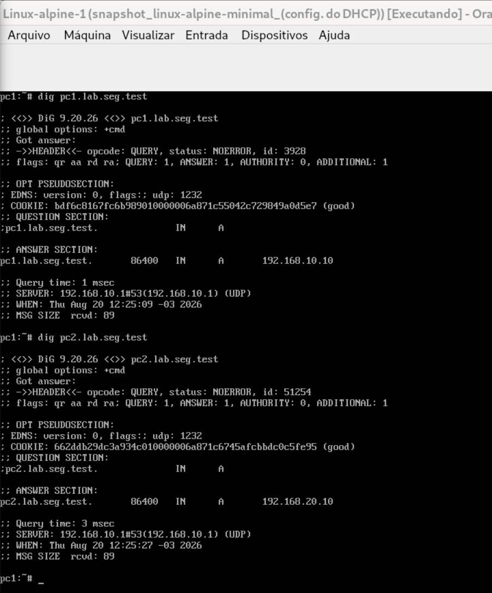

<br>

Neste teste de resolução Direta de nomes, podemos ver que o PC1, a VM Linux-alpine-1, ela faz a pergunta ao servidor autoritativo interno a partir dos nomes dos dois hosts internos da rede e recebe de volta os seus respectivos endereços IPs:


- **dig pc1.lab.seg.test:** 192.168.10.10
- **dig pc2.lab.seg.test:** 192.168.20.10


<br>

4. **T04: Resolução reversa (dig -x pc1 e dig -x pc2)**


<br>

Já no teste de resolução Reversa, podemos ver que o PC2, a VM Linux-alpine-2, ela faz a pergunta ao servidor autoritativo interno a partir dos endereços IPs dos dois hosts internos da rede e recebe de volta os seus respectivos nomes completos:


- **dig -x 192.168.20.10:** pc2.lab.seg.test
- **dig -x 192.168.10.10:** pc1.lab.seg.test


<br>

5. **T05: Conectividade com Gateways (PING de cada cliente ao seu Gateway)**


<br>

- **ip route:** 192.168.10.1
- **ping -c 3 192.168.10.1:** 0% Pacotes Perdidos


<br>

- **ip route:** 192.168.20.1
- **ping -c 3 192.168.20.1:** 0% Pacotes Perdidos


<br> 

6. **T06: PING PC1 para PC2 por nome (PING + captura ou estado de conexão - Permitido e com Resposta)**


<br>

- **ping -c 5 pc2.lab.seg.test:** 0% Pacotes Perdidos


<br>

7. **T07: PING PC2 para PC1 por nome (PING + Registro do Firewall - Bloqueado)**


<br>

Acima, podemos notar que o **PC2** enviou cinco pacotes **ICMP** para o **host pc1.lab.seg.test** e teve 100% de perdas de pacotes, fato que podemos observar logo abaixo na saída de log marcado pelo servidor de firewall com **NFT-FORWARD-DROP**, em que cinco pacotes com timestamp sequenciados foram desprezados pelo firewall, tendo sido o último timestamp de **“Aug 20 12:51:56”**.


<br>

8. **T08: SSH PC1 para Gateway (Conexão ou Tentativa autenticada - Permitido)**


<br>

Na imagem acima, podemos notar que o PC1, a VM Linux-alpine-1, foi bem sucedido ao acessar com SSH o gateway Debian Stable:


- **ssh marcus@192.168.10.1**


<br>

9. **T09: SSH PC2 para Gateway (Tentativa + Log do descarte)**


<br>

Na imagem acima, podemos ver várias tentativas do host PC2, VM Linux-alpine-2, fazer log via SSH com o gateway (192.168.20.1) sem sucesso, sendo que isso pode ser confirmado nos logs do servidor Debian Stable apresentados logo abaixo.


Nos logs do gateway, podemos ver ali as informações de referência, como:


- **Endereço de origem:** SRC=192.168.20.10
- **Endereço de destino:** DST=192.168.20.1
- **Protocolo de transporte:** TCP
- **Porta de destino:** DPT=22


<br>

10. **T10: Persistência (Reiniciar gateway e repetir T03, T06 e T07 - Serviços e Regras continuam ativos)**


Nesta primeira imagem deste último teste, temos alguns aspectos interessantes que podemos observar em nossa rede:


<br>

Veja que no print do terminal **PC1**, que estava logado por SSH ao gateway no momento em que este foi reiniciado, ele perdeu a conexão com o gateway segundo podemos ver pela seguinte mensagem: "Read from remote host 192.168.10.1: Connection reset by peer. Connection to 192.168.10.1 closed. Client_loop: send disconnect: Broken pipe", etc.


Entretanto, mesmo tendo o gateway sido reiniciado, o **PC1** ainda foi capaz de continuar fazendo a sua resolução de nomes, bem como de pingar o host **PC2** de forma bem sucedida, depois que o gateway voltou a operar:


- **dig pc1.lab.seg.test:** 192.168.10.10
- **ping -c 2 pc2.lab.seg.test:** 0% de Pacotes perdidos


<br>

Finalmente, ao repetir o teste de **PING** com resolução de nome do **PC2** para **PC1**:


<br>

Vemos agora que o **PC2** outros cinco pacotes **ICMP** para o host **pc1.lab.seg.test** e teve 100% de perdas de pacotes, fato que podemos observar novamente ao ver a saída de log marcado pelo servidor de firewall com **NFT-FORWARD-DROP**, em que cinco pacotes com timestamp sequenciados foram desprezados pelo firewall, tendo sido o último timestamp agora está marcado como **“Aug 20 14:31:37”**.


<br>

### Captura e Análise de Pacotes e Logs

Utilize tcpdump ou Wireshark para registrar pelo menos três evidências:


- Processo DHCP DORA: Discover, Offer, Request e ACK;
- Consulta e resposta DNS;
- ICMP permitido e tentativa bloqueada pelo firewall.


<br>

1. **Escutando o processo de solicitação de IPs: Discover, Offer, Request e ACK**

No servidor gateway, fazer a captura com o tcpdump:


- **tcpdump -ni enp0s9 port 67 or port 68 -vv**


<br>

E no host **PC2**, usando o comando udhcpc para iniciar um processo de pedido de endereços IPs:


- **udhcpc -i eth0**


<br>

Na imagem abaixo, temos a interessante conversa acontecendo entre o host **PC2** e o gateway/firewall, através de seu servidor Kea DHCP4 negociando endereços de IP para a **Rede-B**.


Nesse sentido, à direita da imagem vemos PC2 iniciar a negociação com um envio de uma mensagem de broadcast de Discover para a rede, que é respondida por algum servidor DHCP na rede (no caso o Kea DHCP4) com um Offer ou Oferta, que pode ter um Request ou Aceite, por parte do host, de forma que se tudo se encaminha de forma natural, toda a negociação é fechada com um ACK do servidor reconhecendo o leasing do endereço de IP, bem como das demais informações.


No lado esquerdo da imagem temos a ferramenta **Tcpdump** escutando na interface **enp0s9** (Rede-B) do gateway/firewall: 

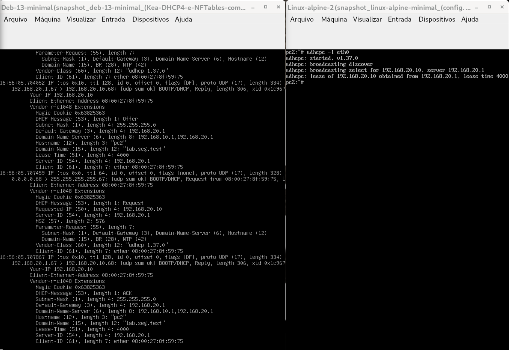

<br>

Assim, à esquerda podemos ver bem acima, um pouco escondida a mensagem de Discover recebida e depois já visível desde o começo a mensagem de resposta do servidor com o Offer. Finalmente, do meio para baixo vemos as mensagens de Request e o ACK, e entre as informações, podemos reconhecer, de um lado e do outro, os dados referente ao serviço sendo passados:


- **Your-IP:** 192.168.20.10
- **Default-Gateway:** 192.168.20.1
- **Domain-Name-Server:** 192.168.10.1, 192.168.20.1
- **Lease-Time:** 4000


<br>

> [!NOTE]
> Interessante notar que o servidor Kea DHCP4 passa os endereços de ambas as interfaces como referência para oa DNS da rede interna!


<br>

2. **Escutando o Processo Consulta e resposta de DNS**

Desta vez temos uma imagem que traz lado a lado, a conversa entre o **PC1** buscando o gateway/firewall, que a partir de seu serviço de DNS (BIND9) faz para o host a resolução do seu nome, **pc1.lab.seg.test**, mapeando para endereço para o qual ele está autorizado a ser referência para a rede interna.


- **tcpdump -ni enp0s8 port 53 -vv**
- **dig pc1.lab.seg.test**

<br>

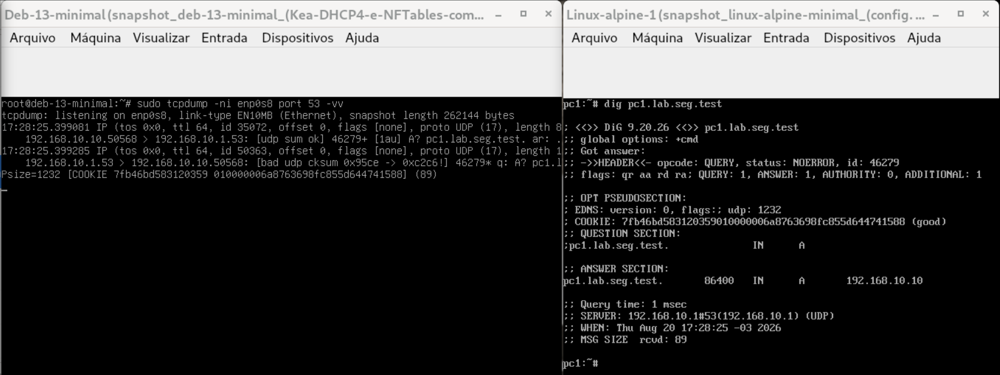

<br>

Vemos do lado esquerdo duas mensagens, sendo a primeira do host (192.168.10.10), buscando o servidor na porta 53 (192.168.10.1) em que uma pergunta é feita envolvendo o um nome de recurso (A? pc1.lab.seg.test).


A resposta vem logo abaixo, saindo do servidor (192.168.10.1) para o host **PC1** (192.168.10.10), que embora não esteja toda visível, responde:


- **"[...]A? pc1.lab.seg.test 1/0/1 A 192.168.10.10[...]"**


<br>

3. **Escutando Permissão e Bloqueio pelo firewall de Mensagem ICMP na Rede Interna**

Na primeira imagem, vemos que o **tcpdump** escutando na interface **enp0p8**, Rede-A, escuta duas trocas de mensagens ICMP, sendo se tratam de duas duplas de mensagens:


- **tcpdump -ni enp0s8 icmp**
- **ping -c2 pc2.lab.seg.test**

<br>

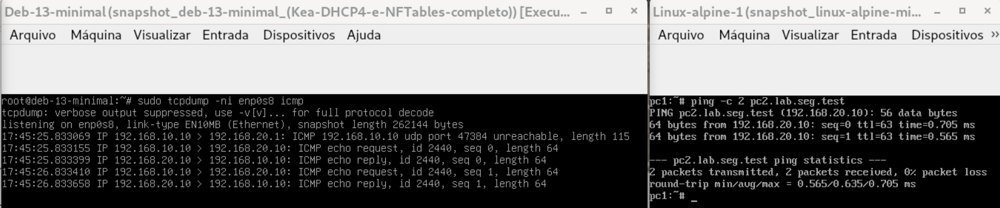

<br>

- **Echo request:** 192.168.10.10 -> 192.168.20.10
- **Echo reply:** 192.168.20.10 -> 192.168.10.10
- **0% de Perdas de pacotes**


<br>

> [!NOTE]
> Observamos apenas a presença de uma mensagem prévia encaminhada pelo gateway/firewall (192.168.20.1), que segundo consta seria justamente o trabalho do gateway de fazer atualizações na tabela **ARP**, que como não excedeu o tempo limite de resposta para a conversa em curso, isso não teria gerado qualquer perda de pacotes (coisa que poderia ter sido diversa, talvez, numa rede com latência, em que a primeira mensagem enviada poderia ter sido perdida, enquanto as demais poderiam obter sucesso)  


<br>

Já nesta última imagem desta seção, observamos também abaixo como responde a interface de rede quando esta está trabalhando com restrições da passagem de pacotes, que nesse caso podemos atentar para o fato das duas mensagens de **Echo Request** terem ficado sem disparar qualquer tipo de resposta, de modo que no terminal do host **PC2**, temos **100% de perdas de pacotes**.


- **tcpdump -ni enp0s9 icmp**
- **ping -c 2 pc1.lab.seg.test**

<br>

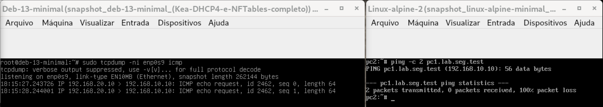

<br>

### Comandos de Diagnósticos

1. **ip -br address:** imprime uma saída básica das interfaces na forma tabular

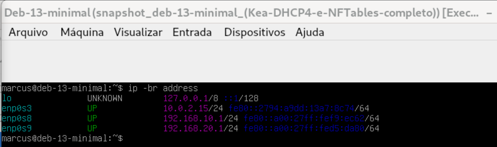

<br>

2. **ip route:** imprime informações de rota, relacionando as interfaces de rede presentes, bem com o Default Gateway.

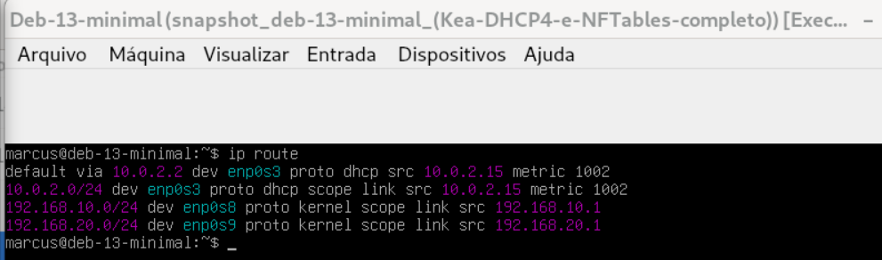

<br>

3. **ss -lntup:** comando de diagnóstico de sockets, que lista na forma numérica os sockets TCP, UDP e outros processos

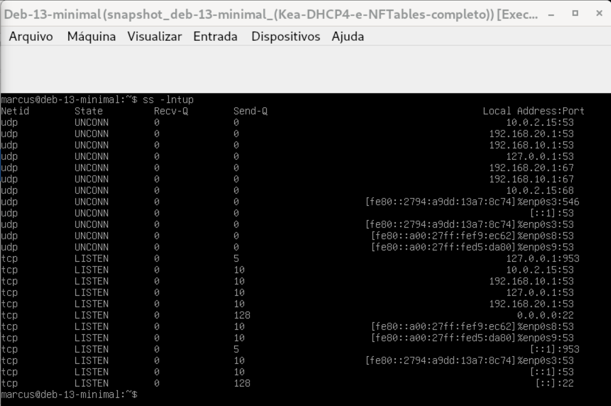

<br>

4. **sysctl net.ipv4.ip_forward:** comando de gerenciamento e de diagnóstico de parâmetros correntes do Kernel (leitura e modificação). Já no caso da diretiva net.ipv4.ip_forward, ela é responsável por definir o parâmetro de encaminhamento ou roteamento do kernel, que no caso deste print e do laboratório foi configurado como ativo ‘1’, de forma que o valor ‘0’, ao contrário, significa o desligamento desta diretiva. 

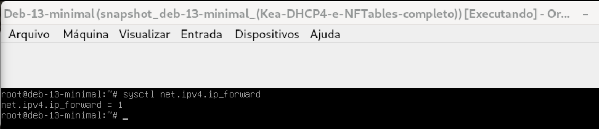

<br>

5. **nft list ruleset:** lista as regras correntes sendo usadas pelo firewall nftables

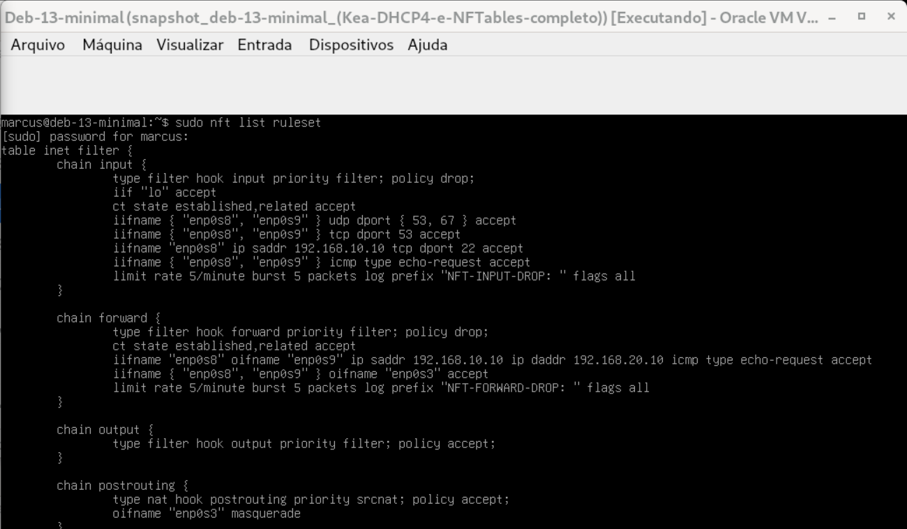

<br>

6. **conntrack -L:** lista conexões sendo acompanhadas pelo kernel e pelos subsistemas do kernel

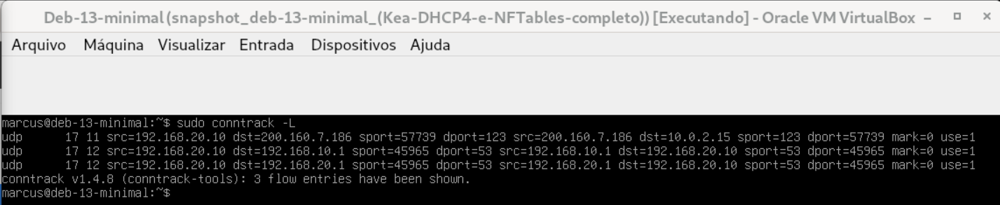

<br>

7. **journalctl -u nftables:** apresenta mensagens de log do sistema de gerenciamento do host que se chama systemd, bem como de seus serviços. Neste comando estão sendo especificados as mensagens relacionadas à unidade de serviço do firewall NFTables.

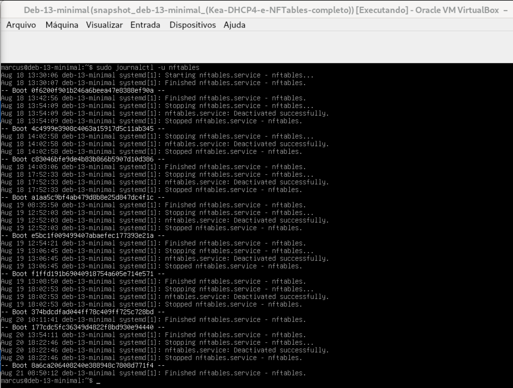

<br>

8. **journalctl -u kea-dhcp4-server:** apresenta mensagens de log do sistema de gerenciamento do host que se chama systemd, bem como de seus serviços. Neste comando estão sendo especificados as mensagens relacionadas à unidade de serviço do servidor Kea DHCP4.


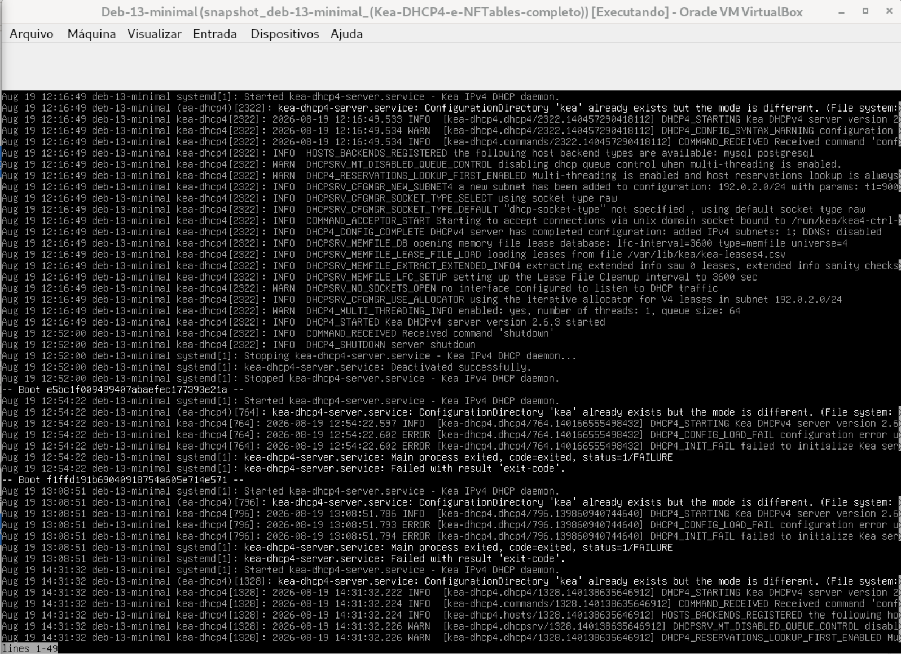

<br>

9. **journalctl -u bind9:** apresenta mensagens de log do sistema de gerenciamento do host que se chama systemd, bem como de seus serviços. Neste comando estão sendo especificados as mensagens relacionadas à unidade de serviço do servidor de nomes BIND9.

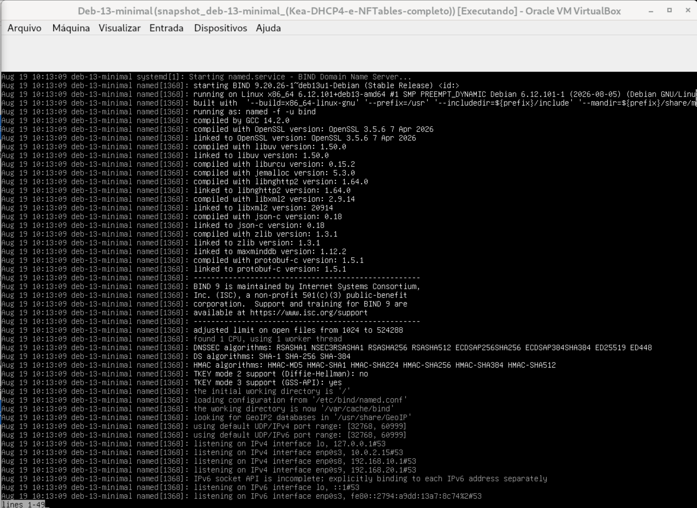

<br>

> [!NOTE]
> Observe que na distribuição Debian (e seus derivados), nas versões mais atuais, os logs normalmente estão concentrados no módulo NAMED, responsável por gerenciar serviços de resolução de nomes.


<br>

### Considerações Finais

Este laboratório apresentou um excelente desafio para o aprendizado de redes e de infraestrutura de sistemas, trazendo objetivos muito importantes relacionados a aspectos de virtualização de dispositivos, configuração e administração de sistemas operacionais, configuração e administração de serviços de rede, controle de acesso por SSH, além de incluir segurança de redes e firewall. 


Por tudo isso, fica evidente se tratar de um desafio extenso, mas que permitiu que se cobrisse todo o ciclo de vida da gestão dos sistemas trabalhados (DHCP, DNS, Firewall, etc.), cobrindo desde a instalação das aplicações, a configuração dos serviços e a gestão necessária para ser possível alcançar sucesso nos testes realizados.


Outra dificuldade está relacionada à necessidade de planejamento e economia de recursos do sistema, uma vez que estão envolvidos neste laboratório o trabalho com uma grande quantidade de recursos e de processos, coisa que se tornou mais fácil de lidar na medida de se encontrar no mundo Open Source, incluindo no ecossistema Linux, a disponibilização de muitos recursos destinados racionalizar os gastos de recursos e de processos. 


Finalmente, quanto aos aprendizados, estes foram muitos e todos significativos, porque envolveram trabalhar cada etapa do ciclo de vida da infraestrutura necessária para suportar uma rede de computadores, aplicando ainda segurança e boas práticas aos serviços. 


<br>

### Apêndice

#### 1. Arquivo /etc/nftables.conf

```
#!/usr/sbin/nft -f

flush ruleset

table inet filter {
    chain input {
        type filter hook input priority filter; policy drop;

        # 1. Permitir tráfego de Loopback
        iif "lo" accept

        # 2. Permitir conexões ESTABLISHED e RELATED
        ct state established,related accept

        # 3. Permitir DHCP e DNS SOMENTE pelas interfaces internas (enp0s8 e enp0s9)
        iifname { "enp0s8", "enp0s9" } udp dport { 53, 67 } accept
        iifname { "enp0s8", "enp0s9" } tcp dport 53 accept

        # 4. Permitir administração SSH do Gateway SOMENTE a partir do PC1 (192.168.10.10)
        iifname "enp0s8" ip saddr 192.168.10.10 tcp dport 22 accept

        # 5. Permitir PING (ICMP) vindo de qualquer rede interna para diagnosticar o Gateway
        iifname { "enp0s8", "enp0s9" } icmp type echo-request accept

        # 6. Registrar pacotes descartados com limite de taxa (Rate Limit)
        limit rate 5/minute log prefix "NFT-INPUT-DROP: " flags all

        # Política padrão: DROP
    }

    chain forward {
        type filter hook forward priority filter; policy drop;

        # 1. Permitir conexões ESTABLISHED e RELATED (Respostas de conexões já iniciadas)
        ct state established,related accept

        # 2. Permitir que o PC1 (Rede A) inicie PING para o PC2 (Rede B)
       # Note: A resposta do PC2 voltará automaticamente graças à regra ESTABLISHED acima
        iifname "enp0s8" oifname "enp0s9" ip saddr 192.168.10.10 ip daddr 192.168.20.10 icmp type echo-request accept

        # 3. Permitir navegação WAN (Internet) para as redes internas A e B
        iifname { "enp0s8", "enp0s9" } oifname "enp0s3" accept

        # 4. Registrar pacotes descartados (ex: PING do PC2 para o PC1) com limite de taxa
        limit rate 5/minute log prefix "NFT-FORWARD-DROP: " flags all

        # Política padrão: DROP (Bloqueia novos PINGs iniciados pelo PC2 para o PC1)
    }

    chain output {
        type filter hook output priority filter; policy accept;
    }
}

table ip nat {
    chain postrouting {
        type nat hook postrouting priority srcnat; policy accept;

        # 1. Traduzir Endereços (NAT / Mascaramento)
        oifname "enp0s3" masquerade
    }
}
``` 


<br>

#### 2. Arquivo Kea DHCP4

- /etc/kea/kea-dhcp4.conf

```
{
  "Dhcp4": {
    "interfaces-config": {
      "interfaces": [ "enp0s8", "enp0s9" ]
    },
    "lease-database": {
      "type": "memfile",
      "persist": true,
      "name": "/var/lib/kea/kea-leases4.csv"
    },
    "valid-lifetime": 4000,
    "max-valid-lifetime": 7200,

    "option-data": [
      {
        "name": "domain-name-servers",
        "data": "192.168.10.1, 192.168.20.1"
      },
      {
        "name": "domain-name",
        "data": "lab.seg.test"
      }
    ],

    "subnet4": [
      {
        "id": 1,
        "subnet": "192.168.10.0/24",
        "pools": [ { "pool": "192.168.10.100 - 192.168.10.200" } ],
        "option-data": [
          {
            "name": "routers",
            "data": "192.168.10.1"
          }
        ],
        "reservations": [
          {
            "hw-address": "08:00:27:XX:XX:XX",
            "ip-address": "192.168.10.10",
            "hostname": "pc1"
          }
        ]
      },
      {
        "id": 2,
        "subnet": "192.168.20.0/24",
        "pools": [ { "pool": "192.168.20.100 - 192.168.20.200" } ],
        "option-data": [
          {
            "name": "routers",
            "data": "192.168.20.1"
          }
        ],
        "reservations": [
          {
            "hw-address": "08:00:27:YY:YY:YY",
            "ip-address": "192.168.20.10",
            "hostname": "pc2"
          }
        ]
      }
    ]
  }
}
```


<br>

#### 3. Arquivo /etc/bind/named.conf (e demais arquivos alterados do BIND9)

- /etc/bind/named.conf.options

```
options {
        directory "/var/cache/bind";

        # Escuta em todas as interfaces IPv4
        listen-on port 53 { any; };

        # Permite consultas a partir do localhost e das redes A e B
        allow-query { localhost; 192.168.10.0/24; 192.168.20.0/24; };

        # Encaminhadores para sites externos da Internet (Google DNS)
        forwarders {
                8.8.8.8;
                8.8.4.4;
        };

        dnssec-validation auto;
};

/etc/bind/named.conf.local
# Zona Direta
zone "lab.seg.test" {
    type master;
    file "/etc/bind/db.lab.seg.test";
};

# Zona Reversa da Rede A (192.168.10.0/24)
zone "10.168.192.in-addr.arpa" {
    type master;
    file "/etc/bind/db.192.168.10";
};

# Zona Reversa da Rede B (192.168.20.0/24)
zone "20.168.192.in-addr.arpa" {
    type master;
    file "/etc/bind/db.192.168.20";
};

``` 


<br>

#### 4. Arquivos das Zonas Direta e Reversas

- /etc/bind/db.lab.seg.test

```
$TTL    86400
@       IN      SOA     gw.lab.seg.test. admin.lab.seg.test. (
                              1         ; Serial
                         604800         ; Refresh
                          86400         ; Retry
                        2419200         ; Expire
                          86400 )       ; Negative Cache TTL
;
@       IN      NS      gw.lab.seg.test.

; Registros do tipo A
gw      IN      A       192.168.10.1
gw      IN      A       192.168.20.1
pc1     IN      A       192.168.10.10
pc2     IN      A       192.168.20.10
```

<br>

- /etc/bind/db.192.168.10

```
$TTL    86400
@       IN      SOA     gw.lab.seg.test. admin.lab.seg.test. (
                              1         ; Serial
                         604800         ; Refresh
                          86400         ; Retry
                        2419200         ; Expire
                          86400 )       ; Negative Cache TTL
;
@       IN      NS      gw.lab.seg.test.

; Registros do tipo PTR (Rede 192.168.10.x)
1       IN      PTR     gw.lab.seg.test.
10       IN      PTR     pc1.lab.seg.test.
```

- /etc/bind/db.192.168.20

```
$TTL    86400
@       IN      SOA     gw.lab.seg.test. admin.lab.seg.test. (
                              1         ; Serial
                         604800         ; Refresh
                          86400         ; Retry
                        2419200         ; Expire
                          86400 )       ; Negative Cache TTL
;
@       IN      NS      gw.lab.seg.test.

; Registros do tipo PTR (Rede 192.168.20.x)
1       IN      PTR     gw.lab.seg.test.
10       IN      PTR     pc2.lab.seg.test.
```


<br> 

#### 5. Arquivo Utilizado para Persistir o Encaminhamento IPv4

```
# Versão do host Gateway/Firewall
# Interface de Loopback (Sempre necessária)
auto lo
iface lo inet loopback

# -------------------------------------------------------------
# Placa 1 (WAN / Internet via NAT do VirtualBox)
# -------------------------------------------------------------
allow-hotplug enp0s3
iface enp0s3 inet dhcp
      post-up sysctl -w net.ipv4.ip-forward=1

# -------------------------------------------------------------
# Placa 2 (LAN A / Gateway da Rede Restrita A)
# -------------------------------------------------------------
auto enp0s8
iface enp0s8 inet static
    address 192.168.10.1
    netmask 255.255.255.0

# -------------------------------------------------------------
# Placa 3 (LAN B / Gateway da Rede Restrita B)
# -------------------------------------------------------------
auto enp0s9
iface enp0s9 inet static
    address 192.168.20.1
    netmask 255.255.255.0
```


<br>

#### 6. Saídas dos comandos: nft list ruleset, ip route e ss -lntup

- Saída do comando: nft list ruleset

``` 
table inet filter {
    chain input {
        type filter hook input priority filter; policy drop;
        iif "lo" accept
        ct state established,related accept
        iifname "enp0s3" tcp dport 22 accept
        iifname { "enp0s8", "enp0s9" } udp dport { 53, 67 } accept
        iifname { "enp0s8", "enp0s9" } tcp dport 53 accept
        iifname "enp0s8" ip saddr 192.168.10.10 tcp dport 22 accept
        iifname { "enp0s8", "enp0s9" } icmp type echo-request accept
        limit rate 5/minute burst 5 packets log prefix "NFT-INPUT-DROP: " flags all
    }

    chain forward {
        type filter hook forward priority filter; policy drop;
        ct state established,related accept
        iifname "enp0s8" oifname "enp0s9" ip saddr 192.168.10.10 ip daddr 192.168.20.10 icmp type echo-request accept
        iifname { "enp0s8", "enp0s9" } oifname "enp0s3" accept
        limit rate 5/minute burst 5 packets log prefix "NFT-FORWARD-DROP: " flags all
    }

    chain output {
        type filter hook output priority filter; policy accept;
    }

    chain postrouting {
        type nat hook postrouting priority srcnat; policy accept;
        oifname "enp0s3" masquerade
    }
}
``` 


<br>

- Saída do comando: ip route

```
default via 10.0.2.2 dev enp0s3 proto dhcp src 10.0.2.15 metric 1002 
10.0.2.0/24 dev enp0s3 proto dhcp scope link src 10.0.2.15 metric 1002 
192.168.10.0/24 dev enp0s8 proto kernel scope link src 192.168.10.1 
192.168.20.0/24 dev enp0s9 proto kernel scope link src 192.168.20.1 
```


<br>

- saída do comando: ss -lntup

```
Netid    State      Recv-Q     Send-Q                              Local Address:Port         Peer Address:Port    Process    
udp      UNCONN     0          0                                       10.0.2.15:53                0.0.0.0:*                  
udp      UNCONN     0          0                                    192.168.20.1:53                0.0.0.0:*                  
udp      UNCONN     0          0                                    192.168.10.1:53                0.0.0.0:*                  
udp      UNCONN     0          0                                       127.0.0.1:53                0.0.0.0:*                  
udp      UNCONN     0          0                                    192.168.20.1:67                0.0.0.0:*                  
udp      UNCONN     0          0                                    192.168.10.1:67                0.0.0.0:*                  
udp      UNCONN     0          0                                       10.0.2.15:68                0.0.0.0:*                  
udp      UNCONN     0          0              [fe80::2794:a9dd:13a7:8c74]%enp0s3:546                  [::]:*                  
udp      UNCONN     0          0                                           [::1]:53                   [::]:*                  
udp      UNCONN     0          0              [fe80::2794:a9dd:13a7:8c74]%enp0s3:53                   [::]:*                  
udp      UNCONN     0          0               [fe80::a00:27ff:fef9:ec62]%enp0s8:53                   [::]:*                  
udp      UNCONN     0          0               [fe80::a00:27ff:fed5:da80]%enp0s9:53                   [::]:*                  
tcp      LISTEN     0          5                                       127.0.0.1:953               0.0.0.0:*                  
tcp      LISTEN     0          10                                   192.168.20.1:53                0.0.0.0:*                  
tcp      LISTEN     0          10                                      10.0.2.15:53                0.0.0.0:*                  
tcp      LISTEN     0          10                                   192.168.10.1:53                0.0.0.0:*                  
tcp      LISTEN     0          10                                      127.0.0.1:53                0.0.0.0:*                  
tcp      LISTEN     0          128                                       0.0.0.0:22                0.0.0.0:*                  
tcp      LISTEN     0          5                                           [::1]:953                  [::]:*                  
tcp      LISTEN     0          10              [fe80::a00:27ff:fef9:ec62]%enp0s8:53                   [::]:*                  
tcp      LISTEN     0          10              [fe80::a00:27ff:fed5:da80]%enp0s9:53                   [::]:*                  
tcp      LISTEN     0          10                                          [::1]:53                   [::]:*                  
tcp      LISTEN     0          128                                          [::]:22                   [::]:*                  
tcp      LISTEN     0          10             [fe80::2794:a9dd:13a7:8c74]%enp0s3:53                   [::]:*                  
```


<br>

#### 7. Arquivos com as Interfaces: /etc/network/interfaces

```
# Versão do host Gateway/Firewall
# Interface de Loopback (Sempre necessária)
auto lo
iface lo inet loopback

# -------------------------------------------------------------
# Placa 1 (WAN / Internet via NAT do VirtualBox)
# -------------------------------------------------------------
allow-hotplug enp0s3
iface enp0s3 inet dhcp
      post-up sysctl -w net.ipv4.ip-forward=1

# -------------------------------------------------------------
# Placa 2 (LAN A / Gateway da Rede Restrita A)
# -------------------------------------------------------------
auto enp0s8
iface enp0s8 inet static
    address 192.168.10.1
    netmask 255.255.255.0

# -------------------------------------------------------------
# Placa 3 (LAN B / Gateway da Rede Restrita B)
# -------------------------------------------------------------
auto enp0s9
iface enp0s9 inet static
    address 192.168.20.1
    netmask 255.255.255.0

# Versão dos hosts das Redes Internas
auto lo
iface lo inet loopback

auto eth0
iface eth0 inet dhcp
```


<br>

## Outros links:

 - [linkedin:] https://www.linkedin.com/in/marcus-vinicius-richa-183104199/
 - [Github:] https://github.com/ahoymarcus/
 - [My Old Web Portfolio:] https://redux-reactjs-personal-portfolio-webpage-version-2.netlify.app/


