# Implantação de Rede IPv4 Segura com Gateway, Firewall (NFTABLES), Serviço de DNS Local e Logs de Segurança

## Cenário da Atividade

Uma organização possui duas redes internas distintas e precisa centralizar os serviços de infraestrutura em um gateway Linux. O equipamento deverá fornecer endereçamento automático, resolução de nomes e roteamento controlado entre as redes. A comunicação não será liberada de forma irrestrita: o firewall deverá aplicar uma política de menor privilégio e registrar tentativas bloqueadas.


**Objetivos de aprendizagem:**
- Construir uma topologia virtual segmentada em duas redes IPv4.
- Configurar interfaces de rede e roteamento entre sub-redes no Linux.
- Implantar DHCP com distribuição de endereço IP, gateway e servidor DNS.
- Implantar DNS com resolução direta e reversa.
- Criar um firewall stateful com nftables e política padrão de bloqueio.
- Diferenciar tráfego iniciado, tráfego de resposta e tráfego não autorizado.
- Interpretar logs, estados de conexão e capturas de pacotes.
- Documentar a implementação e validar os controles por meio de testes positivos e negativos.


**Arquitetura obrigatória**

O laboratório deverá utilizar três máquinas virtuais, sendo o VirtualBox uma das plataformas recomendadas, embora outros hipervisores poderão ser utilizados desde que a topologia e os resultados sejam equivalentes.

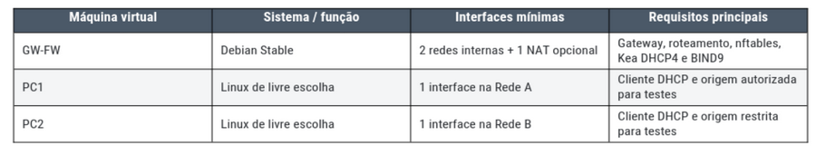

<br>

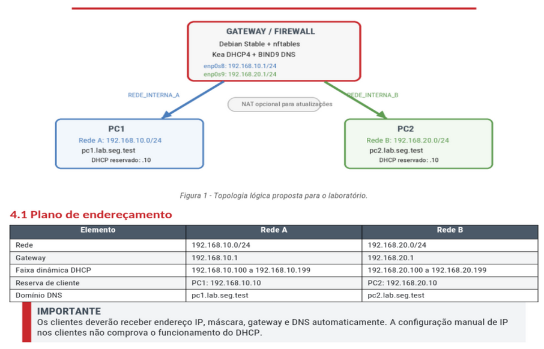


<br>

## Resolução

### Cenário Inicial

Este é um estudo de caso para a matéria “Segurança em Rede de Computadores" do curso de Redes de Computadores - IESB/EAD, no qual estaremos simulando uma infraestrutura de rede com máquinas virtuais, utilizando o VritualBox, sendo que o cenário básico possui estes três hosts: 


1. Debian Stable: versão 13.6.0 (Configuração básica: 512MB e 12 12BG)
2. Alpine Linux: versão 3.24.1 (Configuração básica: 256MB e 5GB)
3. Alpine Linux: versão 3.24.1 (Configuração básica: 256MB e 5GB)


O objetivo geral do experimento é o de criar duas redes internas representadas por cada uma das VMs Alpine Linux, de modo que estas redes internas estejam protegidas por um Gateway/Firewall que será feito pelo host Debian Stable.


Observe ainda, que este Gateway/Firewall deve prover ainda serviços de resolução local de nomes, na forma de um servidor DNS usando Bind9, além de realizar automaticamente a distribuição de endereços IPs, reservados, máscara de rede, gateway padrão e DNS, na forma de um DHCP4 Kea.


O resultado inicial da infraestrutura básica das duas redes internas separadas por um gateway com firewall nftables e com o endereçamento definido estaticamente:

- Rede interna A: 192.168.10.0/24
- Rede interna B: 192.168.20.0/24
- DNS externo: 8.8.8.8 (google.com) 


<br>
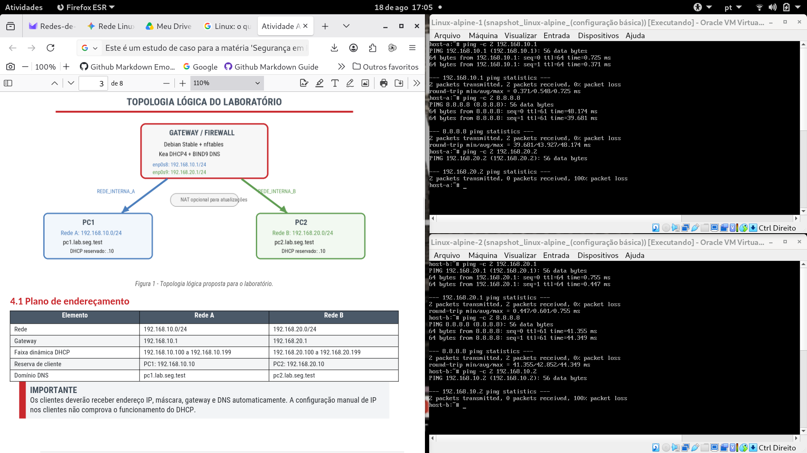


<br>

Podemos notar na imagem acima, que nessa configuração inicial da infraestrutura, as duas redes separadas estão ativas, mas separadas por um firewall nftables com regras básicas, de forma que enquanto o host gateway/firewall permite o tráfego dos hosts internos com ele e com a rede WAN, ele bloqueia o tráfego entre eles respectivamente. 


E como detalhes para a criação das duas redes internas, temos abaixo a configuração de três placas de rede no gateway/firewall Debian Stable no VirtualBox:


1. Placa 1: configurada no modo NAT diretamente no ponto de acesso
2. Placa 2: configurada no modo Rede Interna 
3. Placa 3: configurada no modo Rede Interna

<br>

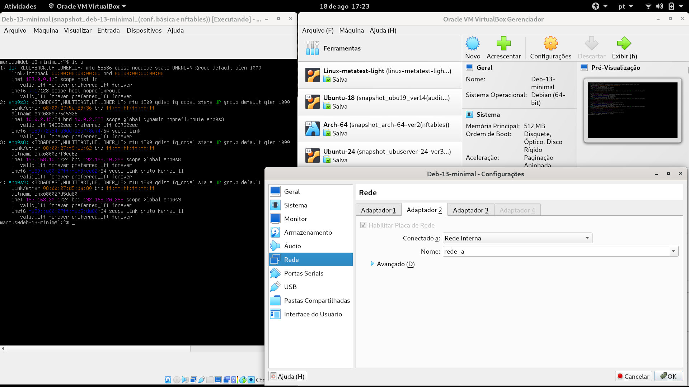

<br>

### Implementação dos Requisitos Técnicos da Infraestrutura

1. **Gateway Linux e Roteamento**

- Utilizar uma versão estável e atualizada do Debian.
- Configurar uma interface para cada rede interna, com os endereços de gateway definidos no plano de endereçamento.
- A terceira interface, em modo NAT, é opcional e deverá ser usada apenas para instalação e atualização de pacotes.
- Habilitar o encaminhamento IPv4 em tempo de execução e de forma persistente.
- Validar as interfaces e rotas com comandos apropriados, incluindo ip -br address e ip route.


A imagem do Debian Stable usado neste projeto foi baixada do site [Debian.org](https://www.debian.org/index.pt.html), tratando-se de um Debian na versão 13.6.0, a qual foi instalada a partir de uma configuração mínima:


- Standard system utilities
- SSH server


O gateway/firewall foi configurado com três interfaces de rede:


1. Rede Loopback: rede interna do kernel do host
2. Rede WAN: caminho de entrada e saída para o roteador da rede principal.
3. Rede Interna-A: 192.168.10.0/24
4. Rede Interna-B: 192.168.20.0/24


Observe que essa configuração foi feita diretamente no arquivo /etc/network/interfaces e está relacionada a cada uma das placas de rede habilitadas na configuração da VM pelo VirtualBox.


A configuração do arquivo como um todo pode ser vista na parte final, na seção de apêndice, enquanto que aqui podemos analisar os principais comandos utilizados:  


- **inet:** esta palavra representa a família IPv4 com a qual se está trabalhando, de modo que se fosse o caso de se trabalhar IPv6, teríamos inet6.
- **lo ou loopback:** é a interface de operação do sistema operacional que permite a comunicação dos processos locais entre si, como, por exemplo, do BIND9 e do DHCP.
- **allow-hotplug:** usar esta diretiva é uma maneira interessante de se evitar que sistema ficasse emperrado em sua inicialização de boot, por causa da dependência para com a conexão da interface WAN, especialmente no momento em que esta estivesse indisponível.
- **auto:** já neste caso o sistema operacional é compelido a ativar obrigatoriamente a interface quando de sua inicialização.
- **static:** diretiva que marca a operação manual de definição do endereço da rede e de sua máscara. 


Note ainda que neste script em /etc/network/interfaces, ele foi escolhido como ponto para a habilitar o recurso de encaminhamento e roteamento de mensagens do host:


- **post-up:** está definido como um ‘hook’ do utilitário ifupdow, que instrui o sistema a rodar rodar o comando apenas após o ativamento bem sucedido da interface.
- **sysctl -w:** é uma ferramenta de linha de comando utilizada para modificar parâmetros do Kernel Linux em tempo de execução. Neste caso, a flag ‘w’ é para gravar o valor ‘1’ no arquivo /proc/sys/net/net.ipv4.ip_forward.


Abaixo, temos a imagem do resultado dos comando ip -br address e ip route, os quais permitem ao administrador retornar as configurações das interfaces do host em tempo real, incluindo a rota de saída WAN:


<br>

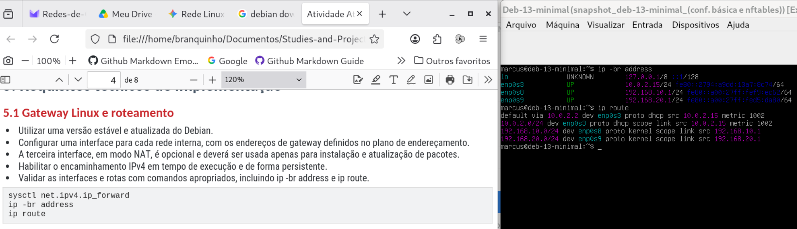

<br>

2. **Serviço DHCP**

- Implantar o Kea DHCP4 no gateway.
- Criar um escopo para cada rede interna.
- Distribuir endereço IP, máscara, gateway padrão e endereço do servidor DNS.
- Criar reservas por endereço MAC para que PC1 receba 192.168.10.10 e PC2 receba 192.168.20.10.
- Apresentar evidências dos leases e da obtenção automática dos parâmetros pelos dois clientes.


Para iniciar com os trabalhos com o serviço Kea DHCP, fazemos as instalações dos pacotes necessários no host:


- **apt update && apt install kea-dhcp4-server -y** 


Assim, no comando acima, fazemos o update do registro de pacotes do host e na sequência fazemos imediatamente a instalação do Kea DHCP e de suas dependências. 


Temos uma ferramenta do servidor Kea DHCP4 para fazer a análise do arquivo de configuração principal com:


- **kea-dhcp4 -t /ect/kea/kea-dhcp4.conf**

 
E, começando a configuração com o arquivo /etc/kea/kea-dhcp4.conf, temos um arquivo extenso do qual podemos sublinhar alguns pontos:


- Está voltado às interfaces das redes internas: enp0s8 e enp0s9
- Traz o nome de domínio da rede local: lab.seg.test
- Cria pools de IPs para as duas sub-redes: 192.168.10.0/24 e 192.168.20.0/24
- Cada sub-rede tem o IP do gateway de sua interface
- E cada host teve uma reserva de endereço: 192.168.10.10 e 192.168.20.10


Na sequência o procedimento é restartar o serviço, checar o estado final e ainda ir até log de serviço:


- **systemctl restart kea-dhcp4-server**
- **systemctl status kea-dhcp4-server**
- **journalctl -xeu kea-dhcp4-server.service**


Neste ponto, é preciso lembrar que o host principal que é o Debian Stable (gateway/firewall), ele teve as suas três interfaces configuradas manualmente pelo arquivo **/etc/network/interfaces**, como visto na seção anterior.


Já os hosts das redes interna, que são versões mais econômicas do sistema Linux, estes tiveram as suas configurações realizadas automaticamente pelo instalador da distro Alpine, o qual ele mesmo escreveu os seus respectivos arquivos de interface passando os IPs (192.168.10.2 e 192.168.20.2), além dos respectivos gateways.


Mas agora que já temos uma instalação funcional do servidor Kea DHCP4, então esses arquivos precisam ser reescritos passando a diretiva de recebimento dos endereços por meio de DHCP:


- **iface eth0 inet dhcp**


E, depois de reescritos os arquivos /etc/network/interfaces dos hosts (pc1 e pc2) das redes internas, é preciso reiniciar o serviço de rede para que as novas configurações possam agir.


Assim, podemos notar na imagem abaixo que nas duas VMs foi reiniciado o serviço de rede, de forma que podemos ver para cada uma delas o processo de descoberta sendo iniciado e depois a seleção aceita para os seus respectivos IPs e Gateways:

<br>

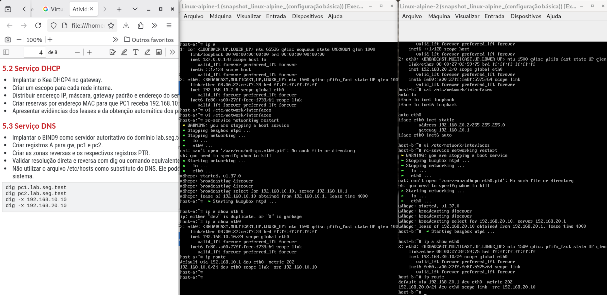

<br>

- **broadcasting discover**
- **broadcasting select for…**
- **Lease of … obtained from …, lease time 4000**
- **ip a show eth0**
- **ip route (default gateway)**


> [!NOTE]
> veja na próxima seção alguns testes relacionados à resolução de nomes pelo servidor DNS.


<br>

3. **Serviço DNS**


- Implantar o BIND9 como servidor autoritativo do domínio lab.seg.test.
- Criar registros A para gw, pc1 e pc2.
- Criar as zonas reversas e os respectivos registros PTR.
- Validar resolução direta e reversa com dig ou comando equivalente.
- Não utilizar o arquivo /etc/hosts como substituto do DNS. Ele poderá conter apenas entradas locais indispensáveis ao
- sistema


Para iniciar com os trabalhos do serviço de DNS, fazemos as instalações dos pacotes necessários no host:


- **apt update && apt install bind9 bind9-utils dnsutils -y**


Como no caso anterior, temos aqui que, o comando acima, faz o update do registro de pacotes do host e na sequência fazemos imediatamente a instalação do BIND9 e de suas dependências. Ademais, antes de começarmos a esmiuçar as principais configurações presentes em **/etc/bind/**, é interessante anotar que o BIND9 oferece uma ferramenta nativa de checagem de erros de sintaxe, da qual esperamos como saída uma mensagem de ‘OK’: **named-checkconf**.


- **named-checkzone lab.seg.test /etc/bind/db.lab.seg.test**
- **named-checkzone 10.168.192.in-addr.arpa /etc/bind/db.192.168.10**
- **named-checkzone 20.168.192.in-addr.arpa /etc/bind/db.192.168.20**


E, ao final das configurações do servidor BIND9, fazemos:


- **systemctl restart bind9**
- **systemctl enable bind9 ou systemctl enable named**


Começando, então, pelas configurações mais gerais em **/etc/bind/named.conf.options**, temos:
 

- **listen-on port 53:** estamos usando a porta padrão para o serviço DNS
- **allow-query { localhost; 192.168.10.0/24; 192.168.20.0/24; }:** estamos acrescentando segurança ao serviço, garantindo que ele esteja aberto para fazer resoluções externa à própria rede.
- **forwarders:** temos aqui um encaminhamento recursivo, ou seja, para as requisições das redes internas que não pertencem à própria rede local (lab.seg.test), mas que dizem respeito ao contexto WAN, o BIND9 as repassa para servidores públicos na Internet. 


A seguir, no arquivo **/etc/bind/named.conf.local**, temos a configuração local para o serviço autoritativo, em que vemos mapeados Zona Direta e Reversas e seus nomes próprios:


- Zona Direta (lab.seg.test)
- Zona Reversa da Rede A (10.168.192.in-addr.arpa): é interessante notar a notação reversa do formato de procura.
- Zona Reversa da Rede B (20.168.192.in-addr.arpa): é interessante notar a notação reversa do formato de procura.


Entendendo um pouco dos registros SOA e Registros de Recursos (RR):


- **/etc/bind/db.lab.seg.test**
- **/etc/bind/db.192.168.10**
- **/etc/bind/db.192.168.20**


Nesses arquivos temos configurações mapeando os ativos principais, em termos de nomes e de endereços, bem como podemos ver também diretivas de comportamento, como a definição de tempo para Refresh, Retry, Expire, etc.


Agora, abaixo temos o teste com pc1 que usa o comando dig para receber do servidor DNS (BIND9), que é a autoridade responsável por responder às resoluções de nome na rede interna:

<br>


<br>

E, de forma mais específica, podemos ver em cada resposta, que:


- **dig pc1.lab.seg.test (resolução direta):** retorna, entre outras coisas, qual é o endereço de IP relacionado com o nome de domínio passado.
- **dig -x 192.168.10.10 (busca reversa):** vemos que agora ao buscar através do endereço de IP, é temos como resposta retornado o nome de domínio relacionado.


A seguir, o mesmo resultado para **pc2**:

<br>


<br>

### Implementação dos Requisitos Técnicos do Firewall NFTables

O firewall utilizado deverá ser o nftables e as regras devem ser organizadas, comentadas e carregadas automaticamente durante a inicialização do sistema.


- Aplicar política padrão drop nas cadeias input e forward.
- Permitir tráfego de loopback e conexões nos estados established e related.
- Permitir DHCP e DNS somente pelas interfaces internas.
- Permitir que PC1 inicie ping para PC2 e receba a resposta correspondente.
- Bloquear novas solicitações de ping iniciadas por PC2 em direção ao PC1.
- Permitir administração SSH do gateway somente a partir do PC1.
- Registrar pacotes descartados com prefixo identificável e limitação de taxa para evitar excesso de logs.
- Manter as regras persistentes após reinicialização.


Lembrando dos aspectos gerais da arquitetura do firewall **nftables**, é preciso apontar que em termos gerais ele trabalha a partir de um do tipo: **Tabela -> Chain -> Regra**.


Nesse sentido, para este trabalho, definimos uma tabela apenas, de modo que ela está definida no padrão inet ou IPv4, para a qual estamos usando quatro das cinco chains existentes (PREROUTING, INPUT, FORWARD, OUTPUT, POSTROUTING):


- **PREROUTING:** responsável por pré-processar pacotes que entram no sistema, antes da decisão de roteamento.
- **INPUT:** responsável por tratar os pacotes destinados ao próprio host de firewall.
- **FORWARD:**  responsável por processar os pacotes de passagem pelo host, ou seja, os pacotes não direcionados ao firewall, mas que precisam ser roteador pela rede.
- **OUTPUT:** responsável por processar os pacotes gerados pelo próprio firewall.
- **POSTROUTING:** responsável por processar os pacotes destinados a serem roteados no momento imediatamente antes de saírem pela interface de rede (por exemplo, a tradução de endereços NAT).


Assim, neste trabalho nós começamos do trabalho do firewall na chain INPUT, definindo a política padrão da chain e permitindo a comunicação interna do host, por meio da interface de loopback, além de estabelecer o controle de estado também, o que significa que o firewall passa a mapear o conjunto das conexões a partir das conexões iniciais.


Isso é relevante principalmente como segurança para os protocolos orientados à conexão, em que um agente malicioso não tem como enviar pacotes soltos ou não iniciados na rede:


- **policy drop;**
- **iff “lo” accept**
- **ca state established,related accept**


A seguir, ainda na cadeia INPUT, permitimos DHCP e DNS apenas pelas interfaces internas, além de restringirmos a administração com SSH apenas a partir do host PC1 (192.168.10.10) na Rede A (192.169.10.0/24):


- **iifname { "enp0s8", "enp0s9" } udp dport { 53, 67 } accept**
- **iifname { "enp0s8", "enp0s9" } tcp dport 53 accept**
- **iifname "enp0s8" ip saddr 192.168.10.10 tcp dport 22 accept**


Finalmente, permitirmos o PING ou echo-request para o próprio diagnóstico do serviço de firewall, e finalizamos a chain registrando em log descartes de log:


- **iifname { "enp0s8", "enp0s9" } icmp type echo-request accept**
- **limit rate 5/minute log prefix "NFT-INPUT-DROP: " flags all**


Na chain FORWARD, novamente foram definidos os padrões da política, com DROP, e de uso de regras de estado:


- **policy drop**
- **ct state established,related accept**


A seguir foi permitido o uso do PING ou echo-request na rede interna, porém de forma limitada, ou seja, podendo ser usado apenas quando iniciado pelo host PC1 da Rede A na direção do host PC2 na Rede B (não confundir com a regra que permite o próprio firewall pode ser pingado pelos hosts para fins de diagnóstico da rede):


- **iifname "enp0s8" oifname "enp0s9" ip saddr 192.168.10.10 ip daddr 192.168.20.10 icmp type echo-request accept**


Finalmente, foi liberado o roteamento da rede interna para a WAN através do encaminhamento das conexões, lembrando ainda que por causa do uso de regras de estado, a rede interna permanece separada e protegida em relação às tentativas de conexão iniciadas pela rede pública ou externa, bem como também foi estabelecido controle de pacotes descartados com política de inscrição em log:


- **iifname { "enp0s8", "enp0s9" } oifname "enp0s3" accept**
- **limit rate 5/minute log prefix "NFT-FORWARD-DROP: " flags all**


A chain de OUTPUT não possui nenhuma regra específica para este laboratório, enquanto que a chain POSTROUTING é responsável justamente por fazer aquela tradução de endereço NAT, para que as conexões iniciadas na rede interna pudessem alcançar a Internet, uma vez que esta não reconhece os endereços privados usados na rede interna:


- **policy accept**
- **oifname "enp0s3" masquerade**


<br>

### Plano dos Testes da Infraestrutura e a Política de Segurança

Em termos de  uma política de segurança, tanto para a instalação, quanto para o uso dos hosts, bem como com relação aos testes em geral, foi escolhido buscar um tipo de configuração que privilegia a ideia de Zero Trust ou da Política de Menor Privilégio, ou seja, a ideia de que cada recurso ou ativo participante da rede pode vir a ser um potencial  recurso hostil ou mesmo ser utilizado como tal por um agente hostil.


Nesse sentido, para este laboratório foram considerados alguns pontos básicos desse padrão para o principal recurso de segurança da rede interna, que é o host Debian Stable (gateway/firewall):


- Policy Drop: padrão do firewall NFTables para definir nas suas chains uma política final para lidar com o tráfego da rede, no sentido de que tudo aquilo que não estiver explicitamente permitido é bloqueado. 
- Resguardar a senha e o usuário do Root:  desta forma o usuário root e a sua senha não se confunde com a de quaisquer outros administradores e usuários do gateway/firewall.
- Proibição de acesso SSH como root: dessa forma, nos acessos administrativos ao host, ele só poderá ser logado por usuário comum, o qual precisará conhecer a senha local do root para ser capaz de realizar qualquer trabalho de administração.


Nesse sentido, para que a regra que impede o acesso do root ao gateway/firewall, fazemos a configuração no arquivo /etc//ssh/sshd_config, na diretiva apresentada abaixo:


- **PermitRootLogin no**


Tendo dito isso, passamos a uma série de dez testes para garantir que os propósitos básicos de segurança deste laboratório puderam ser alcançados ou não:


1. **T01: Obtenção de lease no PC1 (IP, Gateway e Reserva - 192.168.10.10)**


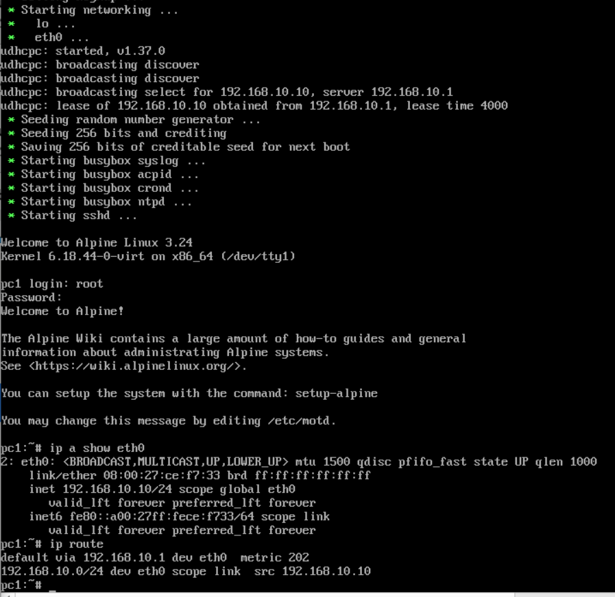

<br>

Como podemos ver na imagem acima, logo na inicialização do PC1, temos o sinal de inicialização da rede, onde podemos ver que há a troca de mensagens de broadcast com o servidor DHCP em busca das informações de endereçamento.


Ademais, com os comandos abaixo podemos confirmar todas essas informações:


- **ip a show eth0:** 192.168.10.10 (PC1)
- **ip route:** 192.168.10.1 (Gateway) 


2. **T02: Obtenção de lease no PC2 (IP, Gateway e Reserva - 192.168.20.10)**

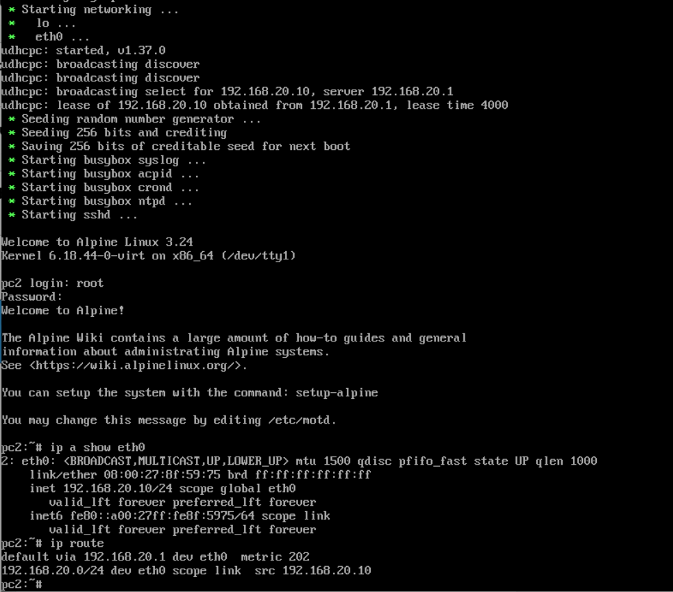

<br>

Como também podemos ver nessa outra imagem, também na inicialização do PC2, temos o sinal de inicialização da rede, onde podemos ver que há a troca de mensagens de broadcast com o servidor DHCP em busca das informações de endereçamento.


Ademais, novamente com os comandos abaixo podemos confirmar todas as informações:


- **ip a show eth0:** 192.168.20.10 (PC1)
- **ip route:** 192.168.20.1 (Gateway) 

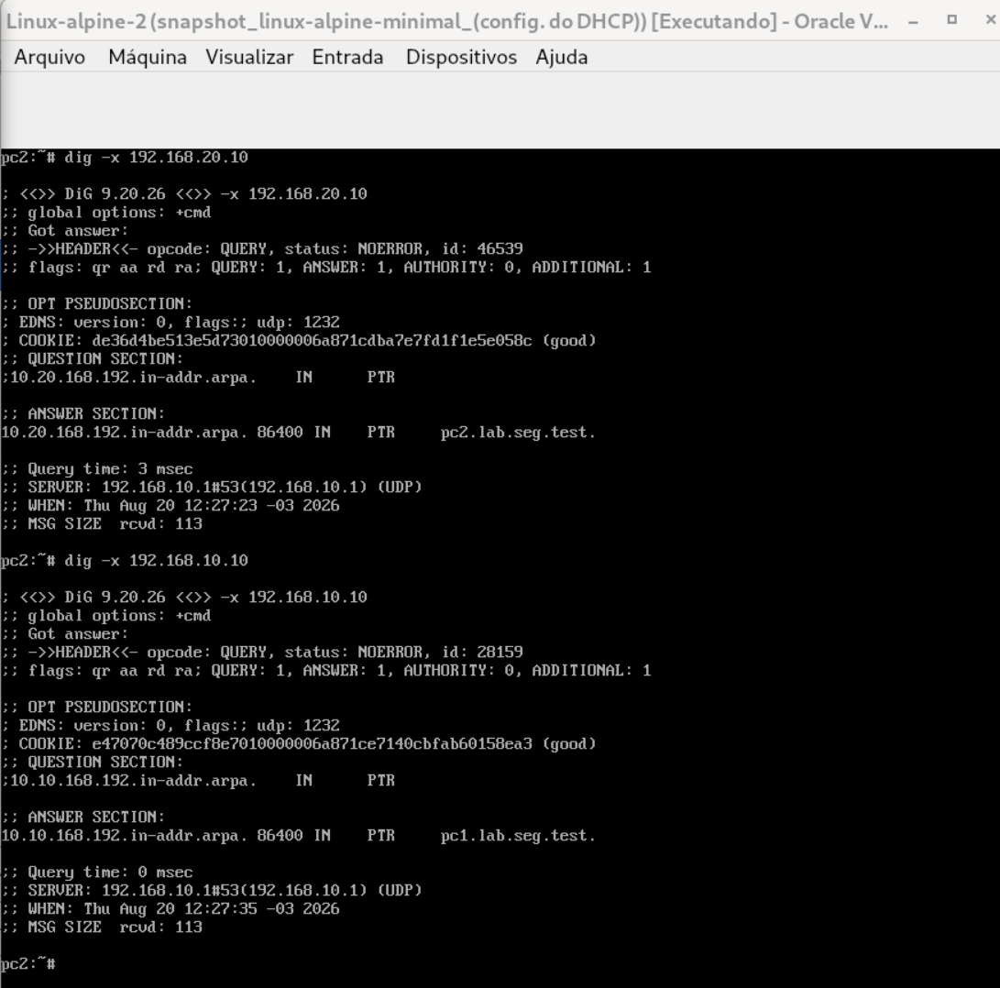

<br>

Já no teste de resolução Reversa, podemos ver que o PC2, a VM Linux-alpine-2, ela faz a pergunta ao servidor autoritativo interno a partir dos endereços IPs dos dois hosts internos da rede e recebe de volta os seus respectivos nomes completos:


- **dig -x 192.168.20.10:** pc2.lab.seg.test
- **dig -x 192.168.10.10:** pc1.lab.seg.test


5. **T05: Conectividade com Gateways (PING de cada cliente ao seu Gateway)**

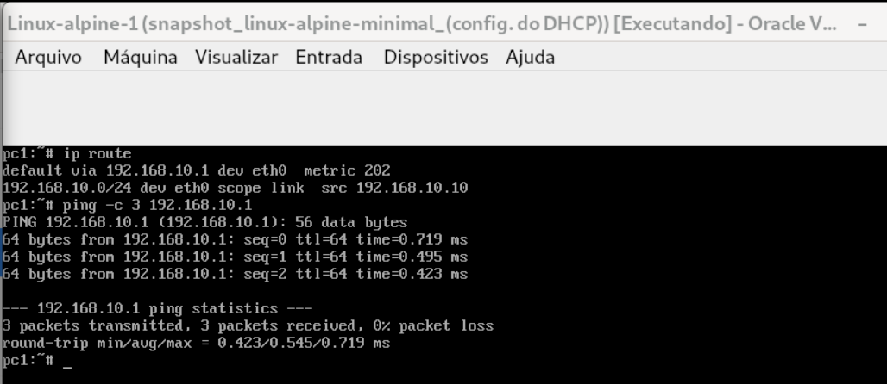

<br>

- **ip route:** 192.168.10.1
- **ping -c 3 192.168.10.1:** 0% Pacotes Perdidos

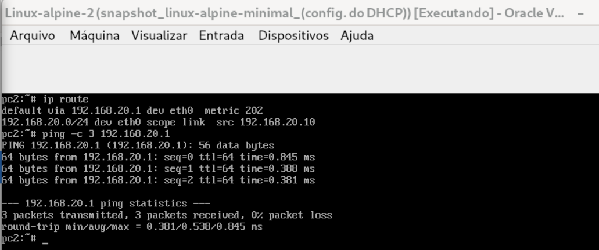

<br>

- **ip route:** 192.168.20.1
- **ping -c 3 192.168.20.1:** 0% Pacotes Perdidos


6. **T06: PING PC1 para PC2 por nome (PING + captura ou estado de conexão - Permitido e com Resposta)**

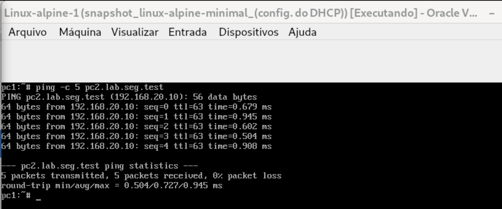

<br>

- **ping -c 5 pc2.lab.seg.test:** 0% Pacotes Perdidos


7. **T07: PING PC2 para PC1 por nome (PING + Registro do Firewall - Bloqueado)**

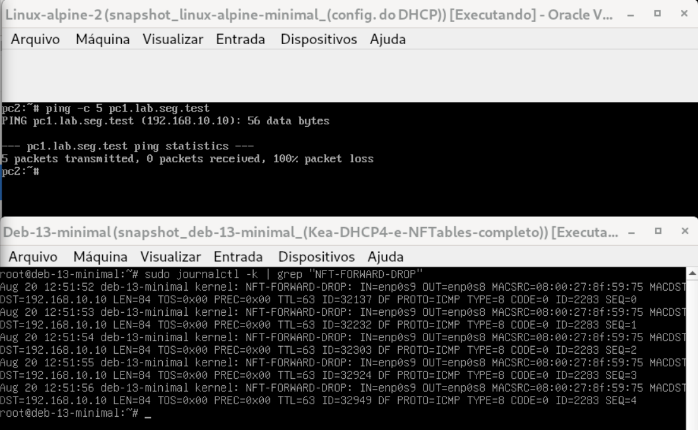

<br>

Acima, podemos notar que o **PC2** enviou cinco pacotes **ICMP** para o **host pc1.lab.seg.test** e teve 100% de perdas de pacotes, fato que podemos observar logo abaixo na saída de log marcado pelo servidor de firewall com **NFT-FORWARD-DROP**, em que cinco pacotes com timestamp sequenciados foram desprezados pelo firewall, tendo sido o último timestamp de **“Aug 20 12:51:56”**.


8. **T08: SSH PC1 para Gateway (Conexão ou Tentativa autenticada - Permitido)**

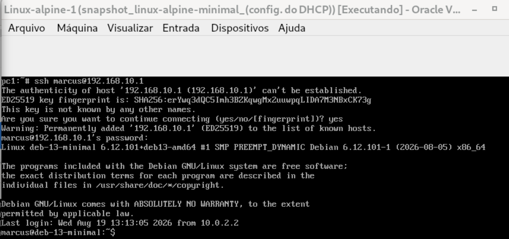

<br>

Na imagem acima, podemos notar que o PC1, a VM Linux-alpine-1, foi bem sucedido ao acessar com SSH o gateway Debian Stable:


- **ssh marcus@192.168.10.1**


9. **T09: SSH PC2 para Gateway (Tentativa + Log do descarte)**

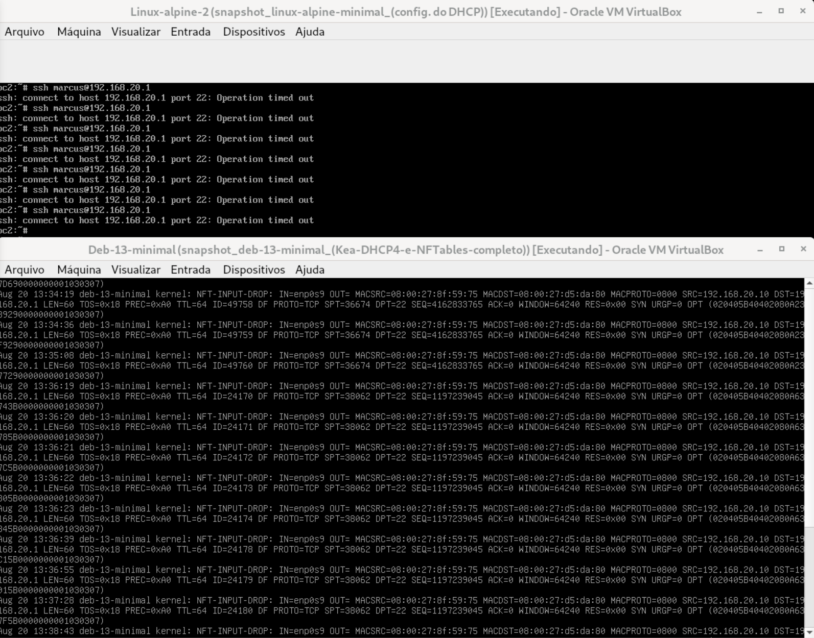

<br>

Na imagem acima, podemos ver várias tentativas do host PC2, VM Linux-alpine-2, fazer log via SSH com o gateway (192.168.20.1) sem sucesso, sendo que isso pode ser confirmado nos logs do servidor Debian Stable apresentados logo abaixo.


Nos logs do gateway, podemos ver ali as informações de referência, como:


- **Endereço de origem:** SRC=192.168.20.10
- **Endereço de destino:** DST=192.168.20.1
- **Protocolo de transporte:** TCP
- **Porta de destino:** DPT=22


10. **T10: Persistência (Reiniciar gateway e repetir T03, T06 e T07 - Serviços e Regras continuam ativos)**


Nesta primeira imagem deste último teste, temos alguns aspectos interessantes que podemos observar em nossa rede:

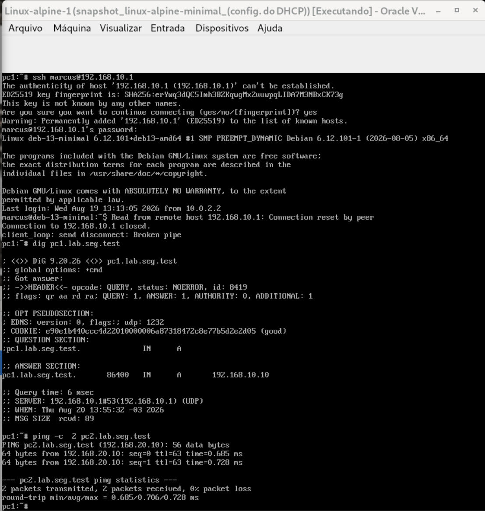

<br>

Veja que no print do terminal **PC1**, que estava logado por SSH ao gateway no momento em que este foi reiniciado, ele perdeu a conexão com o gateway segundo podemos ver pela seguinte mensagem: "Read from remote host 192.168.10.1: Connection reset by peer. Connection to 192.168.10.1 closed. Client_loop: send disconnect: Broken pipe", etc.


Entretanto, mesmo tendo o gateway sido reiniciado, o **PC1** ainda foi capaz de continuar fazendo a sua resolução de nomes, bem como de pingar o host **PC2** de forma bem sucedida, depois que o gateway voltou a operar:


- **dig pc1.lab.seg.test:** 192.168.10.10
- **ping -c 2 pc2.lab.seg.test:** 0% de Pacotes perdidos


Finalmente, ao repetir o teste de **PING** com resolução de nome do **PC2** para **PC1**:

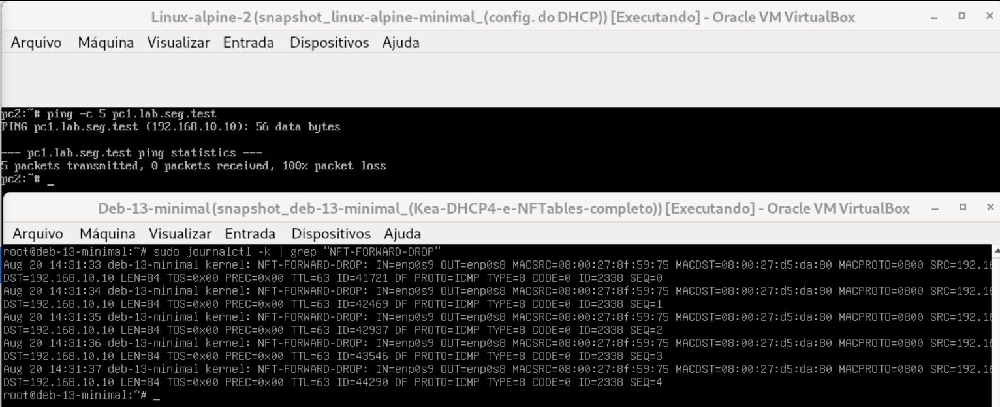

<br>

Vemos agora que o **PC2** outros cinco pacotes **ICMP** para o host **pc1.lab.seg.test** e teve 100% de perdas de pacotes, fato que podemos observar novamente ao ver a saída de log marcado pelo servidor de firewall com **NFT-FORWARD-DROP**, em que cinco pacotes com timestamp sequenciados foram desprezados pelo firewall, tendo sido o último timestamp agora está marcado como **“Aug 20 14:31:37”**.


<br>

### Captura e Análise de Pacotes e Logs


<br>


<br>

<br>


<br>

<br>


<br>


<br>


<br>


<br>


<br>


<br> 

### Desenvolvimento:

Como visto, então, o objetivo deste trabalho é o de buscar as principais dificuldades encontradas pelos gestores e usuários das empresas em trabalhar com esse novo modelo de processo de gestão de TI, chamado mais especificamente de Governança de TI.
Assim, em vistas de se poder definir quais poderiam ser tais dificuldades, este trabalho segue no sentido de primeiro apresentar uma pequena definição do que seria tal modelo de governança de TI, para num segundo momento buscar, seja no material de estudo de nosso curso, seja na literatura de Gestão da TI encontrada na Internet e na Nuvem, possíveis questões que possam ser candidatas para compor as questões a serem transcrevidas para o questionário direcionado à pesquisa de campo.

Para tratar do primeiro ponto apresentado acima, aquele acerca de uma definição corrente para Governança de TI, buscamos, então, no framework Cobit (mantido pela ISACA ou Information Systems Audit and Control Association) que é a ferramenta mais celebrada pela literatura a gestão de TI, uma ferramenta que foi lançada em 1996 e que hoje, na sua última versão, o Cobit 2019, acumulando a expertise e a robustez de grande parte dos conhecimentos experimentados na área de gestão de TI:

> [!NOTE]
> “A Governança de TI garante que as necessidades, condições e opções das partes interessadas (stakeholders) sejam avaliadas para determinar objetivos corporativos equilibrados e acordados; definindo a direção por meio de priorização e tomada de decisão; e monitorando o desempenho e a conformidade em relação à direção e aos objetivos estabelecidos.” (COBIT 2019 Framework: Introduction and Methodology. Schaumburg, IL: ISACA, 2018)


<br>

Ademais, além dessa definição que busca traçar as principais responsabilidades da governança de TI, o Cobit traz três “Pilares de Valor” (EDM02 - Ensured Benefits Delivery: COBIT 2019 Framework: Introduction and Methodology. Schaumburg, IL: ISACA, 2018):

1. Realização de Benefícios: criação de valor por meio de investimentos.
2. Otimização de Riscos: riscos ajustados ao apetite de riscos da empresa e à criticidade dos negócios e das normas/legislação.
3. Otimização de Recursos: garantir a maior eficiência possível às capacidades (pessoas, infraestruturas e aplicações) da empresa.


Já para tratar das principais responsabilidades relacionadas à Implantação de uma Governança de TI, temos visto ao longo do nosso curso que Governança de TI apresenta um novo Ciclo de Vida que é específico desse novo modelo e que precisa ser distinguido daquele que era próprio da gestão de TI mais tradicional:

1. Alinhamento Estratégico e Compliance
2. Decisão, Compromisso, Priorização e Alocação de Recursos
3. Estrutura e Processos. Operações e Gestão
4. Medição e Desempenho


<br> 

Com relação a esse Ciclo de Vida, observamos ao longo do curso que o Alinhamento da TI é o ponto focal de uma Governança de TI, de forma que ele junto com a definição das Necessidades da Partes Interessadas, da criação de uma Comunicação entre todos os setores da empresa, Criação de uma Política de Segurança, Risco e Compliance, estas todas que seriam responsabilidades essenciais de serem planejadas em qualquer projeto para implantação de uma governança de TI.


Finalmente, nas três últimas etapas do ciclo podemos observar ainda derradeiras responsabilidades que podem também afetar o projeto de implantação, de modo que também precisariam ser devidamente modelados a contento: definição de um Mecanismo de Decisão, Critérios de Priorização e de Portfólio, Relacionamento com Usuários, Relacionamento com Fornecedores, Gestão do Valor da TI e Gestão do Desempenho da TI.


Do outro lado, depois de apresentarmos as grandes responsabilidades de uma Governança de TI, podemos também apontar algumas dificuldades gerais relacionadas à Implantação de Governança de TI que têm sido estudadas por alguns grupos e organizações relacionados à Gestão e à Governança e Projetos de TI no mundo:

1. Chaos Report (The Standish Group): apontaria como principais dificuldades ou causas de falhas:
    - Falta de envolvimento dos usuários.
    - Falta de apoio da alta gestão (Executivos)
    - Requisitos incompletos ou em constante mudança.
2. Global Status Report on the Governance of Enterprise IT (GEIT): que por sua vez faz os seguintes apontamentos:
    - Resistência Cultural: travas advindas da própria gestão e dos colaboradores da empresa, colocando a própria Governança como sendo mais um “encargo burocrático” que lhes é imposto.
    - Dificuldade de Medição: as complexidades de se provar o ROI (Retorno sobre Investimentos) relacionados aos processos de TI.
    - Lacuna de Comunicação: a dificuldade do discurso técnico da área de TI de chegar aos executivos e aos gestores dos demais setores da empresa.
3. Gartner Group:
    - Fadiga de Processos: relacionado à tentativa de se implementar todos os processos de Cobit de uma única vez, gerando problemas aos processos em andamento e grande complexidade aos que são remodelados. 


<br> 

### Confecção do Formulário:

Depois de termos falado da especificamente de questões gerais sobre a Governança de TI, de sua evolução e de seus principais processos, passamos, à definição de até oito questões para conformar o formulário para ser lido e respondido por um Gestor e por um Usuário em uma empresa sobre as dificuldades encontradas com relação aos processos de Governança de TI.


Observe que, devido à importância de se determinar inicialmente não apenas a possível existência de dificuldades com relação aos processos de governança de TI da empresa, mas também de se definir se existe na empresa um conhecimento geral acerca da importância dos processos relacionados a ela, bem como a existência de apoio mútuo entre as partes e comprometimento, iniciamos, então, definindo essas três primeiras questões aos nossos leitores.


Nesse sentido, as primeiras questões do questionário, ao nosso ver, têm a importância de determinar o tom dos questionamentos com relação à compreensão do papel da TI em relação à governança estratégica da empresa:

- A empresa possui atualmente um processo de governança específico de TI?
- Seja o Gestor, sejam os Usuários/Colaboradores da empresa, eles entendem a importância de se separar a  Governança de TI e da Gestão Operacional de TI?


<br>

Portanto, para as três primeiras questões, propomos as seguintes redações:

1. Como você definiria a sua relação com os Processos de Governança da sua empresa: como um Gestor ou como um Usuário? 
    - Gestor ou Membro da Alta Direção
    - Usuário ou Colaborador
2. Pensando numa escala de 1 a 5, qual valor indicaria como executivos de alto escalão compreendem o papel estratégico da TI e quais seriam as maiores barreiras para se estabelecer o alinhamento de intenções da TI para com os objetivos da empresa?
3. Culturalmente, quais seriam os maiores entraves existentes à compreensão de que a TI deveria atuar como um importante ativo da empresa, e portanto merecedor de ser pensado como investimento e não como simples gasto? 


Já para as questões remanescentes, cujo o foco seria de buscar por outros tipos de dificuldades mais específicos, como, por exemplo, dos processos de comunicação, riscos, compliance, tudo isso com relação aos processos de governança de TI em geral:   

4. Quais as principais dificuldades de comunicação observadas em relação às partes interessadas (Stakeholders) dentro do processo de governança dos processos? 
5. Quais seriam as maiores dificuldades relacionadas à definição de responsabilidades e à tomada de decisão na TI? Existe o uso de algum tipo de framework para fazer essa atribuição de responsabilidades (como a Matriz RACI, por exemplo)?
6. Quais seriam as maiores dificuldades para engajar, envolver e ganhar a adesão dos colaboradores ou dos usuários aos processos definidos pela governança de TI da empresa para gerir a criação dos produtos ou serviços da empresa?

7. A empresa foi capaz de definir processos eficientes de risco e de compliance de acordo com as necessidades do negócio ou haveria dificuldades implícitas interferindo nesse processo?
8. Considerando que existe uma natural dificuldade no processo de se medir o valor de TI para as empresas, bem como para se lidar com as complexidades da definição de ROI para o negócio, perguntamos se a sua empresa também tem dificuldades nesse sentido?  


<br> 

### Análise Descritiva dos Dados:

Para esta penúltima parte do trabalho, o primeiro passo é a definição da estratégia para a criação do formulário com as questões feitas na seção anterior, bem como de se definir a forma de sua distribuição para gerar os dados para esta pesquisa de campo.
Nesse sentido, com relação à criação do formulário, a ideia é de usar a ferramenta Google Forms, ela que possui uma interface bastante intuitiva e que permite a criação de diferentes tipos de perguntas (múltiplas escolhas, forma de resposta longa, etc.) e que é capaz de gerenciar tanto a publicação do link de endereço para a URL da página da pesquisa, quanto os dados angariados na operação.


> [!IMPORTANT]
> 🔗 Link da pesquisa: https://forms.gle/1ie35UjfhK6qiStM6 


<br>

Já com relação à estratégia de distribuição do formulário, a primeira tentativa foi a de repassar o link da página de pesquisa por email para algumas empresas da região. Entre as empresas, havia também uma importante empresa de marca internacional que oferece tanto produtos eletrônicos, quanto mantém um contrato de terceirização para prestar assistência técnica aos clientes. 


Contudo, até o momento do fechamento deste trabalho os emails não foram retornados e nem o formulário respondido. Cabe apontar que de acordo com o que foi possível observar, as empresas em geral não pareciam ter gestores especializados em TI, inclusive aquela empresa multinacional, que também mantinha um responsável especializado em tecnologia.


Outra estratégia utilizada enquanto eram esperadas as respostas aos emails, foi a de postar na mídia social do Linkedin uma chamada para a participação da comunidade na pesquisa de campo. O texto utilizado na postagem pode ser visto no Apêndice II deste trabalho. 


Provavelmente em função da minha lista restrita de contatos, também não houve até o momento do fechamento deste trabalho resposta por parte da comunidade do Linkedin, o que nos levou a utilizar uma terceira estratégia de apoio, que se definiu pela criação de dados mokados e pela sua subsequente análise com a ferramenta Google Sheets. 


Com relação ao processo de geração dos dados foram criados diferentes casos de respostas para cada questão e depois foram feitos sorteios simples, simulados por meio do uso de ferramentas ou linguagnes de programação.


Poderiam ser usados recursos de sistema operacional, como os do Linux, que possui tanto a variável $RANDOM (echo $((RANDOM % 15)), quanto o comando shuf (shuf -i 1-100 -n 1) do Bash do Linux, que gerava número aleatório para escolher cada uma das respostas para as 8 questões.


No entanto, neste trabalho fora utilizada a linguagem Python, mais especificamente a biblioteca **Pandas** para fazer o sorteio de itens para responder o questionário criado, gerando, então, uma amostra de **10 Casos de Teste** dos questionários das dificuldades de gestores e de colaborados com processos de governança de TI para serem analisados.


Nesta primeira parte do script, temos a importação das bibliotecas de apoio e a definição de uma estrutura de dados de dicionário contento os itens de respostas para cada questão e que devem ser sorteados para o preenchimento de cada um dos **10 Casos de Testes** para análise:

```
import pandas as pd
import random

# Definir dicioário de dados
dados_base = {
    "Cargo": ["Gestor", "Usuário ou Colaborador"],
    "Alta Direção": ["Falta de alinhamento estratégico", "Falta de comprometimento da liderança", "Falta de apoio da diretoria", "Falta de integração entre diretorias"],
    "Cultura": ["Resistência cultural", "Falta de verbas e recursos", "Gastos desnecessários", "Altos custos dos processos", "Processos não criam valor", "Problemas de escala", "Mentalidade contrária às mudanças", "Falta de agilidade", "Dificuldade na adoção de Frameworks"],
    "Comunicação": ["Inexistência de base de conhecimentos", "Falta de padronização", "Excesso de documentação", "Pouca transparência", "Falta de eventos", "Inexistência de meios de comunicação"],
    "Responsabilidades": ["Inexistência de políticas de posse", "Falta de clareza nos processos", "Problemas com portfólio de TI", "Falta de liderança gerencial", "Falta de mapeamento de necessidades", "Incapacidade na gestão de dados"],
    "Engajamento": ["Processos burocráticos", "Falta de entendimento das regras", "Falta de treinamento", "Escassez de talentos", "Dificuldades no gerenciamento", "Problemas de relacionamento/suporte"],
    "Risco e Compliance": ["Falta de integração", "Excesso de regras", "Ineficiência/Perda de agilidade", "Complexidade excessiva", "Sistemas legados", "Incapacidade com novas tecnologias", "Problemas de segurança", "Conformidade/Sustentabilidade", "Falta de gestão de mudanças", "Falta de gestão de incidentes", "Falta de gestão de continuidade"],
    "Medição e Avaliação": ["Ineficiência de KPIs", "Dificuldade em apresentar ROI", "Monitoramento deficiente", "Dificuldade na otimização", "Falta de feedback", "Metas não realistas"]
}
```


<br>

Já nesta segunda parte, temos o loop iterativo que vai fazer o preenchimento dos 10 formulários:

```
# Criar os casos de teste (iniciar com 10 amostras)
lista_final_de_casos = []

for i in range(1, 11):
    # IMPORTANTE: criar um dicionário novo para cada caso
    novo_caso = {"ID_Caso": f"Caso {i}"}
   
    # Percorrer cada cadegoria de Questões
    for categoria, opcoes in dados_base.items():
        escolha = random.choice(opcoes)
        novo_caso[categoria] = escolha

    # Adicionar o dicionário de caso individual (com as 8 Questões)
    lista_final_de_casos.append(novo_caso)


# Converter dados para DataFrame (Tabela)
df = pd.DataFrame(lista_final_de_casos)

# Visualizar o resultado final
print(df.head())
```


<br>

Finalmente, nesta terceira e última parte do script temos a função Python que vai exportar o resultado final com os dados construídos para um arquivo de formato **CSV** que será utilizado para a análise e para a construção de relatório por meio da ferramenta Sheets da Google:

```  
# Salvar dados finais em Excel/CSV:
#df.to_csv("amostra_governanca_ti.csv", index=False)

#print("---------------------------")
#print("Arquivo gerado com sucesso!")
```


<br>

Abaixo, temos um pequeno sample dos dadoss que foram gerados:

  ID_Caso  ...            Medição e Avaliação
0  Caso 1  ...      Dificuldade na otimização
1  Caso 2  ...      Dificuldade na otimização
2  Caso 3  ...  Dificuldade em apresentar ROI
3  Caso 4  ...  Dificuldade em apresentar ROI
4  Caso 5  ...           Ineficiência de KPIs


De qualquer forma, ao final do processo, após serem gerados os 10 formulários respondidos, estes passaram a ser analisados por este trabalho seguindo o seguinte procedimento:


<br>

Assim, inicialmente podemos ver que, apesar de alguns itens parecerem ter tido uma maior frequência nas respostas, que a amostra ainda parece ter uma distribuição bastante heterogênea, tal qual poderíamos esperar encontrar em situações reais de medição das dificuldades de Governança de TI, uma vez que seria apropriado de se esperar que no caso concreto da observação de diferentes empresas, de diferentes ramos, de diferentes tamanhos e com metas muito específicas, que os desafios apresentados também haveriam de ser bastante específicos a cada uma das operações existentes em cada uma das empresas.


E, continuando no processo de descrição da amostra de dados de simulação, interessante notar também os resultados específicos observados nas questões 2 e 8, respectivamente, sobre a “Alta Direção” e sobre a “Medição e Avaliação”, porque elas parecem tocar em dois fenômenos interessantes para o processo de uma Governança de TI:

1. A Hipótese da Criação de Silos Organizacionais: essa ideia estaria relacionada à criação ou à existência de uma separação ou espaço entre cada uma das áreas ou setores da empresa, criando algo como “silos” que impediram os processos da empresa de fluirem de um lado a outro dentro da empresa.
2. A Geração de Um Sintoma de Falta de Feedback: esta poderia ser a observação de que por estarem separadas e ilhadas as partes ou setores da empresa, que esta falta de integração poderia acabar por impedir as comunicações de ocorrerem ou poderia criar ruído suficiente para prevenir que os processos de Medição e de Avaliação criados para fazer o acompanhamento contínuo dos processos de governança de TI pudessem refletir a verdadeira realidade dos processos que acontecem dentro da empresa.


<br>

Finalmente, essa hipotética correlação observada aqui neste simples processo de sorteio de uma amostra de dados de governança de TI, parece implicar ainda que além daquela presunção inicial de que as dificuldades no mundo real haveriam de ser fortemente influenciadas pelo caso concreto de cada empresa (diferentes ramos, tamanhos, metas, etc.), de que deveria haver também forte influência entre diferentes tipos de problemas ou dificuldades entre si, ou seja, de que os problemas de governança não se apresentariam meramente de forma isoladas umas das outras.


<br>

De qualquer forma, mesmo considerando se tratar de uma pesquisa de campo simulada, parece que temos ainda outra interessante correlação de resultados entre as dificuldades ou problemas de governança de TI, que é a encontrada entre as questões 3 e 6, respectivamente, sobre “Cultura” e sobre “Engajamento de Usuários”, porque nelas podemos ver como respostas mais frequentes as dificuldades respectivas: “Mentalidade Contrária às Mudanças” e “Falta de Treinamento”.


Isto porque, poderíamos esperar que também nesses casos, observando-se a realidade concreta das empresas (principalmente no Brasil), o treinamento de colaboradores poderia ser visto antes como interrupção de trabalho ou perda de tempo ou de valor, do que como um ativo relevante para o processo de governança de TI da organização.


Seja como for, considerando esta situação hipotética que alcançamos aqui nessa pesquisa simulada, poderíamos pensar que o problema ou dificuldade apresentado na Questão 2 (Cultura) como aversão ou mentalidade contrária à mudanças não poderia ser tratado senão pela tentativa de se alcançar diretamente os colaboradores da empresa através de treinamentos específicos aplicados para poder ajudá-los a atravessar todo esse processo de mudanças que devem ocorrer durante a implantação de uma governança de TI bem sucedida:


> [!IMPORTANT]
> 💡 Insight de Governança:
> Sintoma: Baixo Engajamento.
> Causa Identificada: Falta de Treinamento.
> Impacto Cultural: Resistência a novos modelos e frameworks.


<br>

### Conclusão: Recomendações Práticas

Nesta última etapa do trabalho, pensamos que falarmos de “Recomendações Práticas” seria uma forma interessante de se concluir este relatório para que, afinal, é uma pesquisa de campo, ainda que simulada, que visa descobrir as principais dificuldades ou problemas enfrentados por gestores e usuários para lidar com os processos de governança de TI.  


Nesse sentido, respondendo aos dados gerados nesta simulação de pesquisa de campo e considerando especialmente as observações feitas na etapa anterior, entendemos poderiam ser recomendações valiosas a observadas num processo de implantação de uma Governança de TI as seguintes: 

1. Workshop de Integração: para ajudar à tratar aquele problema diagnosticado de “silos organizacionais” dentro da organização e mitigar assim a dificuldade procurando impulsionar o trabalho conjunto entre as diferentes diretorias e a Alta Direção atuando em coesão dentro da empresa.
2. Programa de Alfabetização digital/TI: voltado para ajudar no engajamento dos colaboradores, procurando transformar o sentimento geral de aversão às mudanças, bem como de reduzir o atrito organizacional em geral em função das mudanças realizadas com a implantação dos novos processos de governança de TI.
3. Criação de Canais de Feedback: a estruturação destes canais seria essencial para fechar todo o ciclo de vida das medições, uma vez que apenas a partir de informações confiáveis sobre os processos de governança de TI em uso é que as avaliações realizadas por sobre os KPIs e sobre as Metas empresariais serviriam realmente para auxiliar no processo de tomada de decisões (Data-Driven Decision).   


<br>

## Apêndice I: Formulário

### Governança Estratégica: Burocracia ou Estratégia?

Este formulário busca compreender quais seriam as principais dificuldades encontradas por gestores e usuários ao lidar com os processos de Governança de TI.

* Indica uma pergunta obrigatória

1. Como você definiria a sua relação com os Processos de Governança da sua empresa: como um Gestor ou como um Usuário?  *

Marcar apenas uma oval.

 - [ ] Gestor ou Membro da Alta Direção
 - [ ] Usuário ou Colaborador

---

2. Pensando numa escala de 1 a 5, qual valor indicaria como executivos de alto escalão compreendem o papel estratégico da TI e quais seriam as maiores barreiras para se estabelecer o alinhamento de intenções da TI para com os objetivos da empresa? *

Ex: Falta de apoio da diretoria, visão da TI apenas como custo, dificuldade em comunicar o valor da tecnologia para o negócio.

---

3. Culturalmente, quais seriam os maiores entraves existentes à compreensão de que a TI deveria atuar como um importante ativo da empresa, e portanto merecedor de ser pensado como investimento e não como simples gasto? *
Ex: Resistência cultural, falta de verba, falta de treinamento.

---

4. Quais as principais dificuldades de comunicação observadas em relação às partes interessadas (Stakeholders) dentro do processo de governança dos processos? *

Ex: Uso de termos técnicos excessivos, falta de reuniões de acompanhamento, falta de padronização para as operações dos setores.

---

5. Quais seriam as maiores dificuldades relacionadas à definição de responsabilidades e à tomada de decisão na TI? Existe o uso de algum tipo de framework para fazer essa atribuição de responsabilidades (como a Matriz RACI, por exemplo)? *
Ex: Falta de uma política para atribuição de posse específica para ativos específicos,  conflitos entre departamentos.

---

6. Quais seriam as maiores dificuldades para engajar, envolver e ganhar a adesão dos colaboradores ou dos usuários aos processos definidos pela governança de TI da empresa para gerir a criação dos produtos ou serviços da empresa? *
Ex: Usuários acham os processos burocráticos ou não entendem o porquê das regras.

---

7. A empresa foi capaz de definir processos eficientes de risco e de compliance de acordo com as necessidades do negócio ou haveria dificuldades implícitas interferindo nesse processo? *

Ex: Processos de segurança que travam a agilidade do negócio.

---

8. Considerando que existe uma natural dificuldade no processo de se medir o valor de TI para as empresas, bem como para se lidar com as complexidades da definição de ROI para o negócio, perguntamos se a sua empresa também tem dificuldades nesse sentido? *

Ex: Dificuldade em provar financeiramente que um novo servidor ou software trouxe
lucro.


<br>

## Outros links:

 - [linkedin:] https://www.linkedin.com/in/marcus-vinicius-richa-183104199/
 - [Github:] https://github.com/ahoymarcus/
 - [My Old Web Portfolio:] https://redux-reactjs-personal-portfolio-webpage-version-2.netlify.app/


